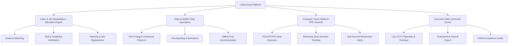

# LabourLens - Project Context

## 1. Project Identity & Background

**LabourLens** is an enterprise AI-driven labor monitoring, workforce allocation, and safety compliance platform developed as an undergraduate Final Year Project (FYP). 

In traditional industries—such as construction, manufacturing, industrial warehousing, and mining—workforce management and safety monitoring remain fraught with structural inefficiencies:
- **Attendance Fraud & Time Theft**: "Buddy punching" and manual sign-in sheets cost enterprises millions in unverified billable hours.
- **Suboptimal Job-Skill Matching**: Labor dispatchers rely on ad-hoc phone calls or spreadsheets, mismatching worker trade proficiencies, certifications, and distance to jobsites.
- **Industrial Safety Accidents**: Non-compliance with Personal Protective Equipment (PPE) mandates and unauthorized entry into hazardous zones cause severe injuries, project delays, and punitive regulatory fines.
- **Lack of Real-time Operational Visibility**: Project managers lack a unified source of truth regarding on-site crew presence, productivity rates, and safety incidents.

LabourLens resolves these friction points by merging **Geofenced & Biometric Mobile Attendance**, **Explainable AI (XAI) Labor-to-Job Matching**, **Computer Vision Safety Monitoring (YOLOv8)**, and an **Executive Management Command Center**.

---

## 2. Core Stakeholders & Audience

1. **Enterprise Contractors & Project Owners**: Seeking lower labor waste, verified work hours, and adherence to safety quotas.
2. **Site Supervisors & Dispatchers**: Needing tools to schedule shifts, match trade workers to daily tasks, and track real-time crew roll calls.
3. **Health, Safety & Environment (HSE) Officers**: Requiring automated video analytics to flag missing PPE (helmets, vests, boots) and hazardous zone intrusions before accidents occur.
4. **Field Laborers & Tradespeople**: Benefiting from transparent hour logging, prompt dispatching based on verifiable skill ratings, and safer work environments.
5. **Academic FYP Evaluation Committee**: Assessing software engineering rigor, machine learning innovation (XAI & edge inference), distributed systems architecture, and mobile engineering excellence.

---

## 3. High-Level System Scope

---

## 4. Operational Boundaries

- **In-Scope**:
  - Web portal (Next.js 14+) with real-time video surveillance overlays, analytics, and dispatching.
  - Mobile application (Flutter 3.x) with offline queueing, GPS polygon geofencing, and local biometric security.
  - Core API (NestJS) handling multi-tenant RBAC, timesheets, and WebSocket notifications.
  - Python AI microservices for both tabular AI matching (XAI recommendations) and streaming vision inference (YOLOv8).
  - PostgreSQL with PostGIS spatial database for geometric boundary computations.

- **Out-of-Scope (Deliberate Constraints)**:
  - Direct processing of fiat banking payments (system outputs payroll-ready timesheets and audit logs for third-party ERP/payroll ingestion).
  - Hardware manufacturing of camera sensors (system consumes standard RTSP / ONVIF video streams from off-the-shelf IP cameras).
