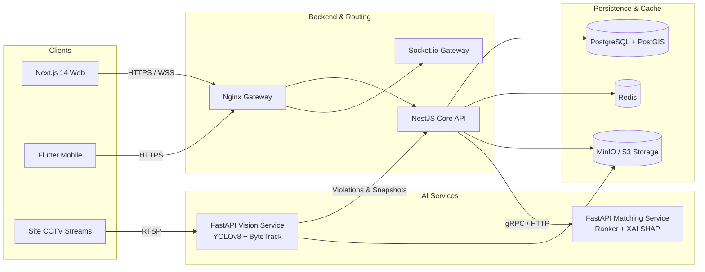

# LabourLens - Project Overview

## 1. Platform Summary

**LabourLens** integrates physical worksite presence, intelligent workforce dispatching, and computer-vision safety governance into a cohesive platform. 

The system operates across three fundamental tiers:
1. **Intelligent Allocation**: Algorithms that analyze job specifications (required trade certifications, safety tier, geographic site, shift timeline) against a pool of verified workers to compute optimal, fair match recommendations.
2. **Field Verification**: A rugged, offline-capable mobile app allowing workers to clock in only when physically inside verified GPS polygon geofences, confirmed with biometric markers.
3. **Automated Safety Surveillance**: An on-premises or cloud-hosted AI vision service processing RTSP camera streams to detect PPE infractions (hard hats, high-vis vests, harnesses) and hazardous area breaches in real time.

---

## 2. Key Value Propositions

| Area | Traditional Approach | LabourLens Solution |
|---|---|---|
| **Attendance Verification** | Paper rosters, RFID card swiping (vulnerable to buddy-punching) | GPS polygon geofencing with mock-location prevention + mobile biometric unlock |
| **Worker Allocation** | Manual dispatcher calls, memory-based scheduling | Multi-objective AI matching (skills, proximity, past reliability, safety record) with Explainable AI (SHAP/feature breakdown) |
| **Safety Governance** | Spot-checks by human safety officers (covers < 5% of active shifts) | 24/7 automated camera stream inspection at 5–10 FPS with instantaneous audio-visual alerting |
| **Data Synchronization** | Fragmented spreadsheets, lost paper tickets | Unified PostgreSQL/PostGIS database with offline-first mobile sync engine |
| **Regulatory Auditing** | Manual compilation of incident records post-accident | Immutable audit trail, automated OSHA compliance logs, and annotated video snapshot evidence |

---

## 3. High-Level System Architecture

---

## 4. Key Metrics & FYP Benchmarks

- **Geofence Query Latency**: $< 20\text{ ms}$ point-in-polygon verification using PostGIS GiST spatial indexing.
- **AI Matching Response Time**: $< 250\text{ ms}$ for candidate pools up to 10,000 workers.
- **Vision Inference Speed**: $\ge 15\text{ FPS}$ on GPU (NVIDIA RTX / T4) using TensorRT-accelerated YOLOv8.
- **Alert Dispatch Latency**: $< 2.5\text{ seconds}$ from camera frame capture to web dashboard notification modal.
- **Offline Durability**: Up to 72 hours of queued mobile attendance and hazard reports without data loss.
