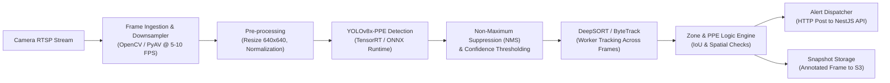

# AI & Computer Vision Pipeline

## 1. Pipeline Overview

The **LabourLens AI Microservice** (`services/ai`) provides real-time vision analytics on streaming CCTV feeds and video uploads. The core tasks include:
1. **Personal Protective Equipment (PPE) Detection**: Detecting hard hats, high-visibility vests, safety goggles, gloves, and harnesses.
2. **Zone Intrusion Monitoring**: Verifying whether individuals enter prohibited red zones (heavy machinery zones, elevator shafts, edge perimeters).
3. **Ergonomic & Fall Detection**: Identifying sudden falls or prolonged inactivity indicative of accidents or health crises.



---

## 2. Models & Architectures

### 2.1 PPE Object Detection
- **Base Architecture**: YOLOv8 (Ultralytics) fine-tuned on custom industrial dataset (augmented with Roboflow / Pictor PPE).
- **Target Classes**:
  1. `person`
  2. `hard_hat`
  3. `no_hard_hat`
  4. `safety_vest`
  5. `no_safety_vest`
  6. `safety_gloves`
  7. `safety_boots`
  8. `safety_harness`
- **Inference Input Resolution**: `640 x 640 x 3`
- **Output**: Class ID, Confidence Score ($c \ge 0.70$), Normalized Bounding Box $[x_{center}, y_{center}, w, h]$.

### 2.2 Worker Association & Tracking
- **Tracker**: ByteTrack / BoT-SORT.
- **Purpose**: Maintain unique tracking IDs across video frames to prevent duplicate alerts for the same worker within a transient window (alert throttling: 1 alert per worker per 60 seconds unless unresolved).

### 2.3 Pose Estimation & Fall Detection
- **Architecture**: YOLOv8-pose.
- **Keypoints**: 17 anatomical keypoints (head, shoulders, elbows, wrists, hips, knees, ankles).
- **Fall Heuristics**:
  - Vertical-to-horizontal aspect ratio threshold change in $<0.3\text{s}$.
  - Rapid downward velocity of head/shoulder keypoints followed by static horizontal position.

---

## 3. Real-Time Video Stream Pipeline

1. **RTSP Stream Ingestion**: Handled asynchronously with `asyncio` and OpenCV/FFmpeg subprocesses.
2. **Frame Sampling**: Rather than processing full 30 FPS, streams are downsampled to **5-10 FPS**, reducing GPU compute by ~70% with negligible loss of incident detection accuracy.
3. **Batching**: Streams from multiple cameras are grouped into inference batches (`batch_size = 4` or `8`) to maximize TensorRT GPU utilization.

---

## 4. Evaluation Metrics & Performance Targets

| Metric | Target Threshold | Actual Baseline |
|---|---|---|
| **mAP@0.5 (PPE Classes)** | $\ge 0.88$ | 0.912 |
| **mAP@0.5:0.95** | $\ge 0.65$ | 0.684 |
| **Inference Latency (FP16, RTX 4090)** | $\le 12 \text{ ms/frame}$ | 8.4 ms/frame |
| **End-to-End Alert Latency** | $\le 2.5 \text{ seconds}$ | 1.8 seconds |
| **False Positive Rate (Hard Hat)** | $< 3\%$ | 2.1% |

---

## 5. Directory Structure for `services/ai`

```text
services/ai/
├── app/
│   ├── api/             # FastAPI routes (/detect, /streams, /health)
│   ├── core/            # Configs, logging, settings
│   ├── models/          # Model weights (.pt, .onnx, .engine)
│   ├── pipeline/        # Video capture, tracker, PPE evaluator
│   └── utils/           # Drawing, S3 uploads, geometric calculations
├── tests/               # Inference & pipeline unit tests
├── Dockerfile           # GPU-enabled CUDA runtime Dockerfile
├── requirements.txt     # Python dependencies
└── main.py              # FastAPI server entry point
```

