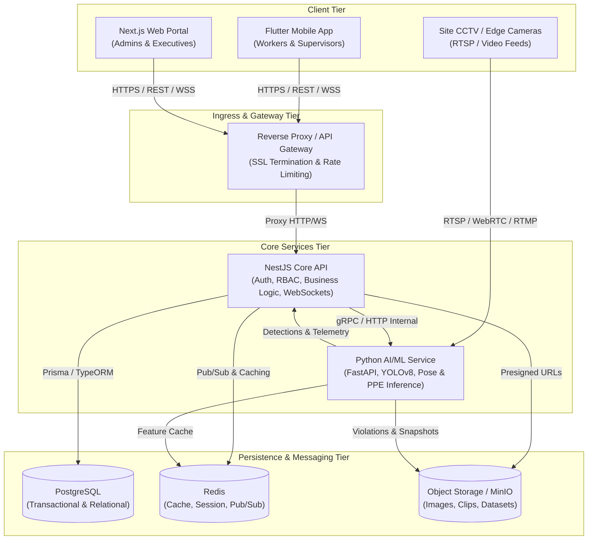

# System Architecture

## 1. Executive Overview

**LabourLens** is a multi-tier, AI-powered workforce monitoring, safety compliance, and productivity analytics ecosystem tailored for industrial sites, construction projects, and large labor forces. The system bridges edge field operations (via Flutter mobile devices and on-site cameras) with enterprise governance dashboards (via Next.js) through a resilient NestJS core backend and high-performance Python AI microservices.

---

## 2. Core Architectural Pillars

### 2.1 Micro-Modular Monorepo Structure
The LabourLens repository operates as a modular multi-stack workspace:
- `apps/web`: Next.js 14+ App Router frontend for site management, live CCTV monitoring, real-time safety alert handling, and executive workforce analytics.
- `apps/mobile`: Cross-platform Flutter application providing GPS geofenced shift check-ins, offline-tolerant task sync, digital hazard reporting, and field supervisor approvals.
- `apps/api`: NestJS enterprise backend implementing domain-driven design (DDD), modular controllers, guards, interceptors, and WebSocket gateways.
- `services/ai`: Standalone Python service hosting PyTorch/ONNX models for computer vision (YOLOv8 PPE gear detection, fall detection, pose estimation, and productivity heatmaps).
- `database`: Unified database migration scripts, relational ER schemas, seed fixtures, and performance tuning configurations.
- `infrastructure`: Docker Compose orchestrations, Nginx reverse proxy configs, monitoring metrics, and cloud deployment manifests.

### 2.2 Communication Protocols
| Channel | Source | Destination | Protocol | Description |
|---|---|---|---|---|
| Client REST | Web / Mobile | NestJS API | HTTPS / JSON | Standard CRUD, profile, shift management, reporting |
| Real-time Alerts | NestJS API | Web / Mobile | WebSockets (Socket.io) | Instant PPE violations, geofence breaches, SOS alerts |
| Video Streaming | On-site Cameras | AI Service | RTSP / WebRTC | Raw video stream ingestion for real-time safety inspection |
| Inter-service RPC | NestJS API | AI Service | gRPC / REST (HTTP/2) | Synchronous model inference requests and batch jobs |
| Cache & Events | NestJS / AI | Redis | TCP / Redis Protocol | Event bus for async detection events and token blacklists |

---

## 3. Subsystem Breakdown

### 3.1 Next.js Web Application (`apps/web`)
- **Rendering Model**: Hybrid SSR and CSR using React Server Components (RSC) and TanStack Query for client data synchronization.
- **Role Interfaces**:
  - *Safety Officer View*: Live video feeds with bounding-box overlays (helmets, vests, boots, harness), violation feed, and audible alerts.
  - *HR & Operations View*: Attendance timesheets, geofence audit trails, shift schedules, overtime calculations.
  - *Executive Summary*: Multi-site productivity indexes, compliance trends, incident reduction rates.

### 3.2 Flutter Mobile Application (`apps/mobile`)
- **State Management**: BLoC (Business Logic Component) pattern for predictable state transitions and offline synchronization.
- **Offline Tolerance**: Local SQLite/Hive database cache. In the event of lost cell coverage on remote construction sites, clock-ins and hazard reports are queued cryptographically and flushed upon network reconnect.
- **Geofencing & Biometrics**: Integration with native Android/iOS location services to enforce polygon boundaries around worksites with anti-spoofing checks.

### 3.3 NestJS Core API (`apps/api`)
- **Authentication**: JWT access tokens (short-lived, 15m) paired with rotating refresh tokens (7d) stored in secure HTTP-only cookies and validated against Redis blacklists.
- **Role-Based Access Control (RBAC)**: Fine-grained declarative decorators (`@Roles()`, `@Permissions()`) protecting all routes.
- **Event-Driven Architecture**: NestJS event emitter handles decoupling between attendance events, safety incident triggers, and notification dispatches.

### 3.4 Python AI Microservice (`services/ai`)
- **Framework**: FastAPI with asynchronous worker pools (Celery / Ray for heavy compute).
- **Inference Engines**: ONNX Runtime and TensorRT acceleration for GPU-accelerated edge and server environments.
- **Models**:
  - *Safety Detection*: Custom fine-tuned YOLOv8 model for PPE detection (Hard Hat, High-Vis Vest, Safety Boots, Gloves, Harness).
  - *Activity Recognition*: Pose estimation (MediaPipe / YOLOv8-pose) to detect idle vs active motion, unauthorized entry into hazardous zones, and worker fall events.

---

## 4. Scalability and Reliability

1. **Stateless Service Design**: Both the NestJS backend and Python AI inference nodes are completely stateless, allowing horizontal pod autoscaling (HPA) under high camera load.
2. **Asynchronous Processing**: Heavy image/video frame processing is decoupled from transactional API paths using Redis message queues.
3. **Data Partitioning**: PostgreSQL table partitioning by month/site on high-volume tables (`attendance_logs`, `ai_detections`) to maintain constant query times over millions of records.
