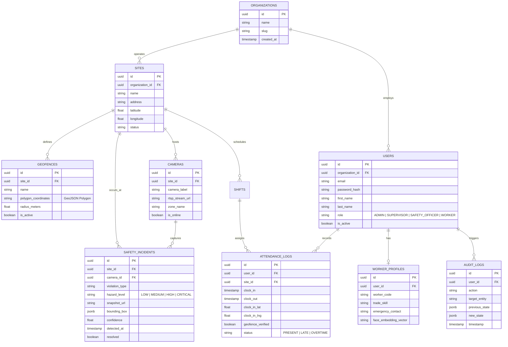

# Database Schema & Data Models

## 1. Overview & Technology Choices

LabourLens employs **PostgreSQL** as the primary relational database system, accessed via **Prisma ORM** in the NestJS backend. PostgreSQL provides ACID compliance for workforce records, spatial indexing via PostGIS for polygon geofencing, and native JSONB columns for flexible AI detection metadata.

---

## 2. Entity-Relationship Diagram (ERD)

---

## 3. Data Dictionary

### 3.1 `users` Table
| Column | Type | Constraints | Description |
|---|---|---|---|
| `id` | UUID | PK, DEFAULT gen_random_uuid() | Unique identifier |
| `organization_id` | UUID | FK -> organizations(id), ON DELETE CASCADE | Associated organization |
| `email` | VARCHAR(255) | UNIQUE, NOT NULL | Account email |
| `password_hash` | VARCHAR(255) | NOT NULL | Argon2id encrypted hash |
| `first_name` | VARCHAR(100) | NOT NULL | User first name |
| `last_name` | VARCHAR(100) | NOT NULL | User last name |
| `role` | VARCHAR(50) | NOT NULL | `ADMIN`, `SUPERVISOR`, `SAFETY_OFFICER`, `WORKER` |
| `is_active` | BOOLEAN | DEFAULT TRUE | Soft disable flag |
| `created_at` | TIMESTAMPTZ | DEFAULT NOW() | Record creation timestamp |
| `updated_at` | TIMESTAMPTZ | DEFAULT NOW() | Record update timestamp |

### 3.2 `attendance_logs` Table (Partitioned by Month)
| Column | Type | Constraints | Description |
|---|---|---|---|
| `id` | UUID | PK | Unique record ID |
| `user_id` | UUID | FK -> users(id) | Associated worker ID |
| `site_id` | UUID | FK -> sites(id) | Check-in worksite |
| `clock_in` | TIMESTAMPTZ | NOT NULL | Check-in timestamp |
| `clock_out` | TIMESTAMPTZ | NULL | Check-out timestamp |
| `clock_in_lat` | NUMERIC(10, 7) | NOT NULL | GPS latitude |
| `clock_in_lng` | NUMERIC(10, 7) | NOT NULL | GPS longitude |
| `geofence_verified` | BOOLEAN | DEFAULT FALSE | Verified inside site polygon |
| `device_id` | VARCHAR(128) | NOT NULL | Mobile device identifier |
| `status` | VARCHAR(32) | NOT NULL | `ON_DUTY`, `COMPLETED`, `FLAGGED` |

### 3.3 `safety_incidents` Table
| Column | Type | Constraints | Description |
|---|---|---|---|
| `id` | UUID | PK | Unique incident ID |
| `site_id` | UUID | FK -> sites(id) | Location of violation |
| `camera_id` | UUID | FK -> cameras(id) | Source camera stream |
| `violation_type` | VARCHAR(64) | NOT NULL | `NO_HELMET`, `NO_VEST`, `RED_ZONE_ENTRY`, `FALL_DETECTED` |
| `hazard_level` | VARCHAR(16) | NOT NULL | `LOW`, `MEDIUM`, `HIGH`, `CRITICAL` |
| `snapshot_url` | TEXT | NOT NULL | S3 bucket URL to annotated image |
| `bounding_box` | JSONB | NOT NULL | Normalized bounding box coordinates `{x, y, w, h}` |
| `confidence` | NUMERIC(4, 3) | NOT NULL | AI model confidence score (e.g. 0.945) |
| `detected_at` | TIMESTAMPTZ | DEFAULT NOW() | Incident timestamp |
| `resolved` | BOOLEAN | DEFAULT FALSE | Flagged as addressed by safety officer |

---

## 4. Indexing & Optimization Strategy

1. **Spatial Indexing**: `CREATE INDEX idx_geofences_spatial ON geofences USING GIST (polygon_geom);` Enables sub-millisecond point-in-polygon queries for mobile check-ins.
2. **Attendance Time-Series Index**: `CREATE INDEX idx_attendance_user_date ON attendance_logs (user_id, clock_in DESC);` Accelerates worker history retrieval.
3. **Safety Incident Feed Index**: `CREATE INDEX idx_safety_site_time ON safety_incidents (site_id, detected_at DESC) WHERE resolved = FALSE;` Speeds up the real-time active incident query.
