# LabourLens Database Architecture & Schema Design

**Status**: Proposed Architecture for Review  
**Database Target**: PostgreSQL 18.7 + PostGIS 3.7.0 (`labourlens_db`)  
**ORM / Data Layer**: Prisma ORM 6.x + Native PostGIS Spatial Queries  
**Target Scope**: Pakistan-Wide Labor & Employment Platform (Domestic Workers, Skilled Trades, Daily/Hourly Wages, Project Hiring)

---

## 1. Executive Summary & Architectural Principles

LabourLens is an Explainable AI-enabled labor marketplace and workforce management platform tailored to Pakistan's diverse employment landscape. The database architecture is designed with the following foundational principles:

1. **Third Normal Form (3NF) Rigor**: Strong normalization eliminates redundant data, prevents update anomalies, and ensures data integrity across complex hiring workflows.
2. **Explicit Decoupling of AI Predictions**: **AI matching scores and recommendations are never stored as permanent attributes on worker profiles.** All AI evaluations are stored as ephemeral, contextual evaluation runs (`match_runs` and `match_factors`) tied to a specific job requisition and model version.
3. **Pakistan-Centric Realities**:
   - **Phone-First Authentication**: Workers and employers may authenticate via mobile phone numbers (+92) or emails.
   - **Bilingual Taxonomy**: Occupational categories and skills support both English (`name_en`) and Urdu (`name_ur`).
   - **Diverse Wage Models**: Daily wage (*dihari*), hourly wages, and fixed milestone project contracts are supported with exact monetary precision (`bigint` minor units in `PKR`).
   - **Trust & Verification**: Distinct records for CNIC verification, police verification certificates, vocational credentials (NAVTTC/TEVTA), and references without over-promising absolute safety guarantees.
4. **PostGIS Spherical Geodesy (SRID 4326)**:
   - Uses `geography(Point, 4326)` to accurately compute meter distances across Pakistan's territory without planar distortion.
   - GiST spatial indexing guarantees sub-millisecond radius filtering (`ST_DWithin`).
   - Privacy-preserving architecture: exact worker household coordinates remain private, while public searches operate on neighborhood/city centroids or randomized spatial buffers.
5. **Auditable & Tamper-Resistant**:
   - State machines use current status columns paired with append-only event ledgers (`application_events`, `payment_transactions`, `moderation_actions`, `audit_logs`).
   - Soft-deletion (`deleted_at timestamptz`) is supported on user-recoverable entities while preserving historical relational integrity.

---

## 2. Complete Entity-Relationship (ER) Diagram

```mermaid
erDiagram
    %% ==========================================
    %% 1 & 2: Identity, Auth, Roles & Permissions
    %% ==========================================
    USERS ||--o{ USER_IDENTITIES : "has (phone/email)"
    USERS ||--o{ AUTH_SESSIONS : "opens"
    USERS ||--o{ PASSWORD_RESET_TOKENS : "requests"
    USERS ||--o{ USER_ROLE_ASSIGNMENTS : "receives"
    ROLES ||--o{ USER_ROLE_ASSIGNMENTS : "assigned_to"
    ROLES ||--o{ ROLE_PERMISSIONS : "includes"
    PERMISSIONS ||--o{ ROLE_PERMISSIONS : "granted_in"

    %% ==========================================
    %% 3, 4 & 8: Profiles, Addresses & Spatial Locations
    %% ==========================================
    USERS ||--o| EMPLOYER_PROFILES : "owns"
    USERS ||--o| WORKER_PROFILES : "owns"
    USERS ||--o{ ADDRESSES : "maintains"
    ADDRESSES ||--o{ JOB_POSTINGS : "locates"

    %% ==========================================
    %% 5, 6 & 7: Taxonomy, Experience, Qualifications, Availability
    %% ==========================================
    CATEGORIES ||--o{ CATEGORIES : "parent_of"
    CATEGORIES ||--o{ SKILLS : "categorizes"
    CATEGORIES ||--o{ WORKER_PROFILES : "primary_category"
    CATEGORIES ||--o{ JOB_POSTINGS : "classifies"
    WORKER_PROFILES ||--o{ WORKER_SKILLS : "possesses"
    SKILLS ||--o{ WORKER_SKILLS : "classified_by"
    WORKER_PROFILES ||--o{ WORKER_EXPERIENCES : "records"
    WORKER_PROFILES ||--o{ WORKER_QUALIFICATIONS : "claims"
    WORKER_PROFILES ||--o{ WORKER_AVAILABILITY : "declares"

    %% ==========================================
    %% 9, 10, 11 & 12: Marketplace, Jobs, Applications, Hires
    %% ==========================================
    EMPLOYER_PROFILES ||--o{ JOB_POSTINGS : "publishes"
    JOB_POSTINGS ||--o{ JOB_REQUIREMENTS : "mandates"
    SKILLS ||--o{ JOB_REQUIREMENTS : "requires_skill"
    JOB_POSTINGS ||--o{ JOB_APPLICATIONS : "receives"
    WORKER_PROFILES ||--o{ JOB_APPLICATIONS : "submits"
    JOB_APPLICATIONS ||--o{ APPLICATION_EVENTS : "history_of"
    JOB_APPLICATIONS ||--o| HIRES : "finalizes_as"

    %% ==========================================
    %% 13 & 14: AI Matching & Explainable AI (XAI)
    %% ==========================================
    JOB_POSTINGS ||--o{ REQUIREMENT_EXTRACTION_RUNS : "analyzed_by"
    REQUIREMENT_EXTRACTION_RUNS ||--o{ EXTRACTED_REQUIREMENTS : "proposes"
    SKILLS ||--o{ EXTRACTED_REQUIREMENTS : "maps_to"
    JOB_POSTINGS ||--o{ MATCH_RUNS : "evaluated_in"
    MATCH_MODELS ||--o{ MATCH_RUNS : "powers"
    MATCH_MODELS ||--o{ MATCH_EVALUATIONS : "benchmarked_by"
    MATCH_EVALUATIONS ||--o{ MATCH_EVALUATION_ITEMS : "samples"
    MATCH_RUNS ||--o{ MATCH_RESULTS : "scores"
    WORKER_PROFILES ||--o{ MATCH_RESULTS : "evaluated_candidate"
    MATCH_RESULTS ||--o{ MATCH_FACTORS : "explained_by"
    JOB_REQUIREMENTS ||--o{ MATCH_FACTORS : "evaluated_against"

    %% ==========================================
    %% 15 & 16: Verification, Trust, Reviews & Ratings
    %% ==========================================
    USERS ||--o{ VERIFICATION_RECORDS : "subject_of"
    USERS ||--o{ VERIFICATION_RECORDS : "reviewed_by"
    WORKER_QUALIFICATIONS ||--o| VERIFICATION_RECORDS : "verified_via"
    HIRES ||--o{ REVIEWS : "contextualizes"
    USERS ||--o{ REVIEWS : "authored_by"
    USERS ||--o{ REVIEWS : "received_by"

    %% ==========================================
    %% 17 & 18: Messaging & Notifications
    %% ==========================================
    JOB_POSTINGS ||--o{ CONVERSATIONS : "relates_to"
    CONVERSATIONS ||--o{ CONVERSATION_PARTICIPANTS : "includes"
    USERS ||--o{ CONVERSATION_PARTICIPANTS : "joins"
    CONVERSATIONS ||--o{ MESSAGES : "contains"
    USERS ||--o{ MESSAGES : "sent_by"
    USERS ||--o{ NOTIFICATIONS : "delivered_to"

    %% ==========================================
    %% 19 & 20: Governance, Complaints & Audit Logs
    %% ==========================================
    USERS ||--o{ COMPLAINTS : "filed_by"
    USERS ||--o{ COMPLAINTS : "reported_against"
    JOB_POSTINGS ||--o{ COMPLAINTS : "associated_job"
    COMPLAINTS ||--o{ MODERATION_ACTIONS : "actioned_through"
    USERS ||--o{ MODERATION_ACTIONS : "executed_by"
    USERS ||--o{ AUDIT_LOGS : "triggered_by"

    %% ==========================================
    %% 21: Payments & Transaction Records
    %% ==========================================
    HIRES ||--o{ PAYMENT_RECORDS : "milestones_of"
    USERS ||--o{ PAYMENT_RECORDS : "payer"
    USERS ||--o{ PAYMENT_RECORDS : "payee"
    PAYMENT_RECORDS ||--o{ PAYMENT_TRANSACTIONS : "lifecycle_events"
```



---

## 3. Core Database Modules Breakdown (21 Modules)

### Module 1: Users & Authentication
- **`users`**: Base account identity (`id UUID PK`, `status`, `preferred_locale`, `created_at`, `updated_at`, `deleted_at`). Completely decoupled from role-specific profiles.
- **`user_identities`**: Normalizes login identifiers. Allows workers to use **mobile phone numbers (+92300...)** and employers to use **email addresses**. Tracks `identity_type` (`EMAIL`, `PHONE`), `normalized_value UNIQUE`, and `verified_at`.
- **`auth_sessions`**: Server-side session tracking storing cryptographic token digests (`token_hash bytea UNIQUE`), user agents, IP hashes, and revocation state (`revoked_at`).
- **`password_reset_tokens`**: Time-limited cryptographic hashes for secure password recovery.

### Module 2: Roles & Permissions
- **`roles`**: System roles (`ADMIN`, `MODERATOR`, `EMPLOYER`, `WORKER`).
- **`permissions`**: Fine-grained capability codes (e.g. `jobs:create`, `workers:verify`, `complaints:moderate`).
- **`user_role_assignments`**: Many-to-many junction (`user_id`, `role_id`) tracking who assigned the role and when.
- **`role_permissions`**: Many-to-many junction (`role_id`, `permission_id`).

### Module 3: Employer Profiles
- **`employer_profiles`**: Extends a user account as an employer.
- Columns: `id UUID PK`, `user_id UUID UNIQUE FK`, `display_name`, `business_name VARCHAR(160) NULL`, `employer_type` (`INDIVIDUAL_HOUSEHOLD`, `CONTRACTOR`, `ENTERPRISE`, `AGENCY`), `ntn_tax_number VARCHAR(50) NULL`, `description TEXT NULL`, `profile_picture_url TEXT NULL`, `hiring_preferences JSONB NULL`, `is_verified BOOLEAN DEFAULT false`, timestamps and soft deletion.

### Module 4: Worker Profiles
- **`worker_profiles`**: Extends a user account as a job-seeking worker.
- Columns: `id UUID PK`, `user_id UUID UNIQUE FK`, `display_name`, `headline VARCHAR(160) NULL`, `profile_picture_url TEXT NULL`, `gender VARCHAR(16) NULL`, `date_of_birth DATE NULL`, `primary_category_id FK`, `bio TEXT NULL`, `experience_months INT DEFAULT 0`, `expected_wage_hourly_minor BIGINT NULL`, `expected_wage_daily_minor BIGINT NULL`, `expected_wage_monthly_minor BIGINT NULL`, `preferred_engagement_type` (`HOURLY`, `DAILY`, `PROJECT`, `ANY`), `verification_level`, `profile_visibility` (`PUBLIC`, `REGISTERED_ONLY`, `PRIVATE`), `is_available BOOLEAN DEFAULT true`, `availability_status` (`AVAILABLE`, `BUSY`, `UNAVAILABLE`), `languages TEXT[] DEFAULT ['ur-PK']`, `portfolio_items JSONB NULL`.
- **Strict Invariant**: No AI matching scores or suitability percentages are stored here.

### Module 5: Worker Skills & Categories
- **`categories`**: Hierarchical category tree with self-referencing `parent_id`. Supports dual-language titles (`name_en`, `name_ur`), slugs, and category classifications (`DOMESTIC`, `SKILLED_TRADE`, `INDUSTRIAL`).
- **`skills`**: Canonical occupational skill catalog linked to categories, with bilingual naming (`name_en`, `name_ur`).
- **`worker_skills`**: Composite primary key (`worker_profile_id`, `skill_id`). Stores self-declared years of experience, numeric proficiency level (1–5), and `evidence_source` (`SELF_DECLARED`, `ASSESSED`, `CERTIFIED`, `SUPERVISOR_ENDORSED`).

### Module 6: Experience & Qualifications
- **`worker_experiences`**: Structured work history records with `role_title`, `employer_name`, `city`, `started_on`, `ended_on`, `is_current`, and description. Includes SQL `CHECK (ended_on IS NULL OR ended_on >= started_on)`.
- **`worker_qualifications`**: Certificates, diplomas, or vocational training credentials (e.g. NAVTTC, TEVTA, Matric, Trade Apprenticeship). Columns include `id UUID PK`, `worker_profile_id UUID FK`, `title`, `issuer`, `qualification_type VARCHAR(50) DEFAULT 'CERTIFICATION'`, `credential_url TEXT NULL`, `issued_on`, `expires_on`, `evidence_source`, and optional link to `verification_record_id`.

### Module 7: Worker Availability
- **`worker_availability`**: Timezone-aware availability windows (`Asia/Karachi`).
- Supports both:
  1. **Recurring weekly schedules**: `day_of_week` (0 for Sunday to 6 for Saturday), `start_time`, and `end_time`.
  2. **Custom calendar date blocks**: `specific_date`, `is_full_day`, or date ranges for seasonal/project laborers.
- Includes `is_available` boolean and engagement preference.

### Module 8: Addresses & Geographic Locations (PostGIS)
- **`addresses`**: Unified spatial address ledger.
- Columns: `id UUID PK`, `owner_user_id FK`, `address_type` (`HOME`, `WORK_SITE`, `OFFICE`), `street_address`, `locality` (e.g. F-10, Gulberg, Clifton), `city` (Islamabad, Lahore, Karachi, Rawalpindi, Peshawar, Quetta, Multan, Faisalabad), `district`, `province`, `postal_code`, `country_code` default `PK`.
- **Spatial Field**: `location geography(Point, 4326)` stores latitude and longitude.
- **Privacy Controls**: `is_exact_private` boolean and `approximate_radius_meters`. Exact coordinates are never served on public API endpoints.

### Module 9: Job Postings
- **`job_postings`**: Employment requisitions published by employers.
- Columns: `id UUID PK`, `employer_profile_id FK`, `address_id FK`, `category_id FK`, `title`, `description`, `engagement_type` (`HOURLY`, `DAILY`, `PROJECT`), `pay_period` (`HOURLY`, `DAILY`, `WEEKLY`, `MONTHLY`, `LUMP_SUM`), `pay_min_minor bigint`, `pay_max_minor bigint`, `currency char(3)` default `PKR`, `required_workers_count`, `urgency_level` (`NORMAL`, `URGENT`, `EMERGENCY_REPLACEMENT`), `start_date`, `end_date`, `status` (`DRAFT`, `PUBLISHED`, `IN_SELECTION`, `FILLED`, `COMPLETED`, `CANCELLED`), `expires_at`.
- Constraints: `CHECK (pay_min_minor >= 0)`, `CHECK (pay_max_minor >= pay_min_minor)`.

### Module 10: Job Requirements
- **`job_requirements`**: Granular criteria evaluated by the matching engine.
- Columns: `id UUID PK`, `job_posting_id FK`, `skill_id NULLABLE FK`, `requirement_type` (`SKILL`, `CERTIFICATION`, `EXPERIENCE`, `LANGUAGE`, `PHYSICAL_FITNESS`, `GENDER_PREFERENCE`), `description`, `is_mandatory` boolean, `minimum_experience_months`, `importance_weight numeric(3,2)` (0.00 to 1.00).

### Module 11: Job Applications & Lifecycle Events
- **`job_applications`**: One record per worker per job requisition (`UNIQUE(job_posting_id, worker_profile_id)`).
  - Columns: `id UUID PK`, `status` (`APPLIED`, `VIEWED`, `SHORTLISTED`, `INTERVIEW_SCHEDULED`, `HIRED`, `REJECTED`, `WITHDRAWN`), `expected_pay_minor bigint`, `cover_note`, `applied_at`, `updated_at`.
- **`application_events`**: Append-only audit history of every status transition:
  - Columns: `id UUID PK`, `job_application_id FK`, `actor_user_id FK`, `from_status`, `to_status`, `reason_note`, `created_at`.

### Module 12: Shortlisting & Hiring Agreements
- **Shortlisting**: Managed cleanly as an application state (`status = 'SHORTLISTED'`) tracked in `application_events`, eliminating redundant tables.
- **`hires`**: Formalized agreement when an application is accepted.
  - Columns: `id UUID PK`, `job_application_id UNIQUE FK`, `employer_user_id FK`, `worker_user_id FK`, `agreed_engagement_type`, `agreed_pay_minor bigint`, `agreed_currency char(3)`, `agreed_pay_period`, `start_date`, `end_date`, `hired_at`, `completed_at`, `cancelled_at`, `status` (`ACTIVE`, `COMPLETED`, `CANCELLED`, `DISPUTED`).

### Modules 13 & 14: AI Matching & Explainable AI (XAI)
- **`match_models`**: Tracks versions of the recommendation algorithm (`id UUID PK`, `model_name`, `model_version UNIQUE`, `algorithm_type`, `parameters_jsonb`, `is_active`, `created_at`).
- **`match_runs`**: Encapsulates a single execution of matching for a specific job (`id UUID PK`, `job_posting_id FK`, `match_model_id FK`, `status`, `candidate_pool_size`, `executed_at`, `expires_at`).
- **`match_results`**: Scoped to a `match_run_id` (`UNIQUE(match_run_id, worker_profile_id)`).
  - Columns: `id UUID PK`, `rank_order int`, `compatibility_score numeric(6,5)` (0.00000 to 1.00000), `confidence_band` (`HIGH`, `MEDIUM`, `LOW`), `is_shortlisted_by_employer`.
- **`match_factors`**: The Explainable AI (XAI) feature attribution layer:
  - Columns: `id UUID PK`, `match_result_id FK`, `job_requirement_id NULLABLE FK`, `factor_type` (`SKILL_MATCH`, `EXPERIENCE_DEPTH`, `DISTANCE_PROXIMITY`, `SALARY_COMPATIBILITY`, `AVAILABILITY_FIT`, `MISSING_MANDATORY_CRITERIA`), `score_contribution numeric(6,5)`, `weight numeric(3,2)`, `outcome` (`POSITIVE`, `NEUTRAL`, `NEGATIVE`, `DISQUALIFIED`), `human_explanation_en`, `human_explanation_ur`.
- **`match_evaluations` & `match_evaluation_items`**: Benchmark suite storing test dataset runs, measured NDCG@3, Precision@3, Mean Reciprocal Rank (MRR), and supervisor feedback judgments.

### Module 15: Verification Records & Trust Architecture
- **`verification_records`**: Evidence-based trust records.
  - Columns: `id UUID PK`, `user_id FK`, `verification_type` (`CNIC_NADRA`, `POLICE_CHARACTER_CERTIFICATE`, `DRIVING_LICENSE`, `VOCATIONAL_CERTIFICATE`, `PREVIOUS_EMPLOYER_REFERENCE`), `verification_status` (`PENDING`, `IN_REVIEW`, `VERIFIED`, `REJECTED`, `EXPIRED`), `document_reference_hash`, `verified_by_user_id NULLABLE FK`, `verified_at`, `expires_at`, `rejection_reason`.
  - Disclaimers: Verification verifies submitted government/issuer documents; it does not provide absolute safety guarantees.

### Module 16: Reviews & Ratings
- **`reviews`**: Two-way feedback grounded exclusively in completed hires.
  - Columns: `id UUID PK`, `hire_id FK`, `author_user_id FK`, `subject_user_id FK`, `author_role` (`EMPLOYER`, `WORKER`), `rating_overall smallint CHECK (rating_overall BETWEEN 1 AND 5)`, `rating_punctuality smallint`, `rating_work_quality smallint`, `rating_safety_compliance smallint`, `review_text`, `is_moderated`, `created_at`.
  - Constraint: `UNIQUE(hire_id, author_user_id, subject_user_id)`.

### Modules 17 & 18: Messaging, Conversations & In-App Notifications
- **`conversations`**: Communication channel (`id UUID PK`, `job_posting_id NULLABLE FK`, `is_closed`, `created_at`, `updated_at`).
- **`conversation_participants`**: Many-to-many junction (`conversation_id`, `user_id`) with `last_read_at` timestamp.
- **`messages`**: Chat messages (`id UUID PK`, `conversation_id FK`, `sender_user_id FK`, `body text`, `is_system_message`, `sent_at`, `deleted_at`).
- **`notifications`**: Targeted user alerts (`id UUID PK`, `recipient_user_id FK`, `notification_type`, `title`, `body`, `payload_jsonb`, `is_read`, `read_at`, `created_at`).

### Modules 19 & 20: Governance, Complaints & Audit Logs
- **`complaints`**: Dispute cases (`id UUID PK`, `complainant_user_id FK`, `accused_user_id NULLABLE FK`, `job_posting_id NULLABLE FK`, `category` (`NON_PAYMENT`, `NO_SHOW`, `HARASSMENT`, `SAFETY_HAZARD`, `PROPERTY_DAMAGE`), `severity` (`LOW`, `MEDIUM`, `HIGH`, `CRITICAL`), `description`, `status` (`OPEN`, `INVESTIGATING`, `RESOLVED`, `DISMISSED`)).
- **`moderation_actions`**: Append-only record of admin interventions (`id UUID PK`, `complaint_id FK`, `admin_user_id FK`, `action_taken` (`WARNING_ISSUED`, `PROFILE_SUSPENDED`, `ACCOUNT_BANNED`, `COMPLAINT_DISMISSED`), `justification_note`, `created_at`).
- **`audit_logs`**: System-wide compliance ledger (`id UUID PK`, `actor_user_id NULLABLE FK`, `action_verb`, `target_entity_type`, `target_entity_id`, `ip_address`, `sanitized_changes_jsonb`, `timestamp`).

### Module 21: Payments & Transaction Records
- **`payment_records`**: Financial obligation records.
  - Columns: `id UUID PK`, `hire_id NULLABLE FK`, `payer_user_id FK`, `payee_user_id FK`, `amount_minor bigint CHECK (amount_minor > 0)`, `currency char(3)` default `PKR`, `payment_method` (`CASH_VOUCHER`, `JAZZCASH`, `EASYPAISA`, `RAAST`, `BANK_TRANSFER`), `payment_status` (`PENDING`, `HELD_IN_ESCROW`, `RELEASED`, `REFUNDED`, `FAILED`), `external_reference_id UNIQUE`.
- **`payment_transactions`**: Append-only event history tracking gateway callbacks, confirmations, idempotency tokens, and timestamps.

---

## 4. PostGIS Spatial Implementation Strategy

### 4.1 Coordinate Reference System & Data Type
- Coordinates use **WGS 84 (SRID 4326)**.
- Data type: **`geography(Point, 4326)`**.
- Standard point constructor:
  ```sql
  ST_SetSRID(ST_MakePoint(longitude, latitude), 4326)::geography
  ```
  *(Crucial: Longitude is passed first, followed by Latitude).*

### 4.2 Spatial Indexing
```sql
CREATE INDEX idx_addresses_location_gist ON addresses USING GIST (location);
```

### 4.3 High-Performance Proximity Query Pattern
To find workers within $R$ meters of a job location:
```sql
SELECT 
    w.id,
    w.display_name,
    ST_Distance(a.location, $job_location) AS distance_meters
FROM worker_profiles w
JOIN addresses a ON a.owner_user_id = w.user_id
WHERE a.address_type = 'HOME'
  AND a.deleted_at IS NULL
  AND ST_DWithin(a.location, $job_location, $radius_meters)
ORDER BY distance_meters ASC
LIMIT $page_size;
```
Using `ST_DWithin` inside the `WHERE` clause leverages the GiST index for boundary filtering before executing `ST_Distance` on candidate records.

### 4.4 Prisma ORM Integration
In `schema.prisma`, PostGIS columns are represented as:
```prisma
location Unsupported("geography(Point, 4326)")?
```
Spatial insertions, distance evaluations, and radius filters are executed via parameterized Prisma queries (`$queryRaw` and `$executeRaw`), preventing SQL injection while maintaining native database query performance.

---

## 5. Indexing Strategy Summary

| Target Query Pattern | Table | Index Definition | Index Type |
|---|---|---|---|
| Phone/Email Authentication | `user_identities` | `UNIQUE(normalized_value)` | B-tree |
| Active Job Search | `job_postings` | `(status, category_id, created_at DESC)` WHERE `deleted_at IS NULL` | B-tree (Partial) |
| Spatial Proximity | `addresses` | `(location)` | GiST |
| Worker Skill Matching | `worker_skills` | `(skill_id, worker_profile_id)` | B-tree |
| Fast Application Lookup | `job_applications` | `UNIQUE(job_posting_id, worker_profile_id)` | B-tree |
| Candidate Ranking Retrieval | `match_results` | `(match_run_id, rank_order ASC)` | B-tree |
| Unread Notifications | `notifications` | `(recipient_user_id, is_read, created_at DESC)` | B-tree (Partial) |
| Audit Trail Inspection | `audit_logs` | `(target_entity_type, target_entity_id, timestamp DESC)` | B-tree |

---

## 6. Alignment with Project Deliverables

All documentation files have been updated and synchronized in `docs/`:
- 📄 [**docs/DATABASE_DESIGN.md**](file:///C:/Users/Salman/Documents/FYP/LabourLens/docs/DATABASE_DESIGN.md) (This document)
- 📄 [**docs/ENTITY_RELATIONSHIPS.md**](file:///C:/Users/Salman/Documents/FYP/LabourLens/docs/ENTITY_RELATIONSHIPS.md) (Cardinals, Foreign Keys, Entity Diagrams)
- 📄 [**docs/DATABASE_DICTIONARY.md**](file:///C:/Users/Salman/Documents/FYP/LabourLens/docs/DATABASE_DICTIONARY.md) (Complete Table & Column Specifications)
- 📄 [**docs/DATABASE_DECISIONS.md**](file:///C:/Users/Salman/Documents/FYP/LabourLens/docs/DATABASE_DECISIONS.md) (Architecture Decisions, Trade-offs & Open Points)
