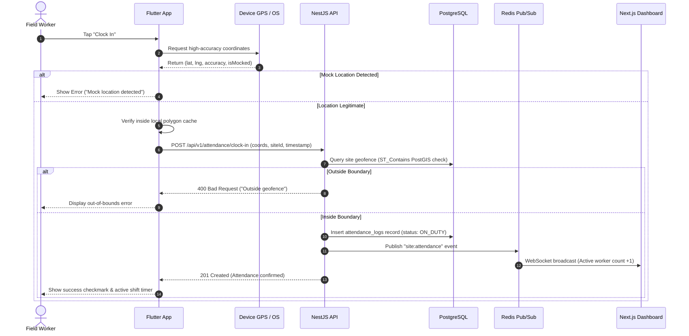
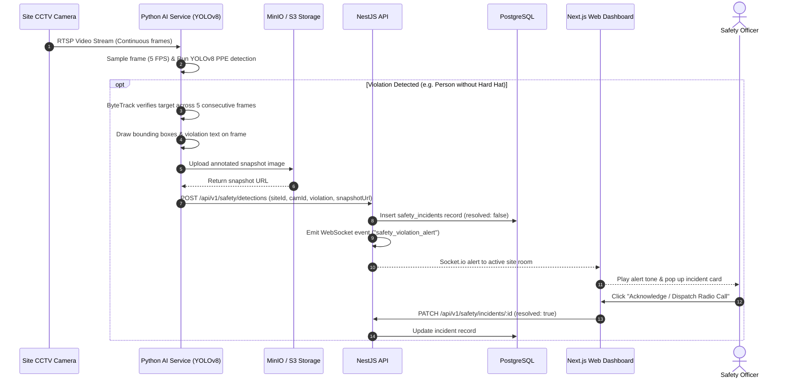
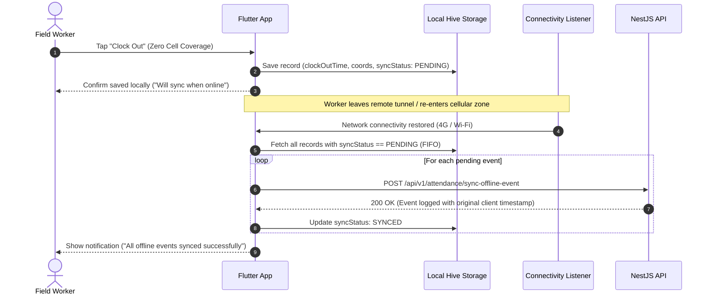

# End-to-End Data Flow & Sequence Workflows

## 1. Overview

This document maps out the end-to-end sequence flows across all tiers of LabourLens: Mobile App, NestJS API, Python AI Service, PostgreSQL DB, Redis Pub/Sub, and Next.js Web Portal.

---

## 2. Workflow 1: Worker Geofenced Clock-In

---

## 3. Workflow 2: Real-Time PPE Safety Violation Detection

---

## 4. Workflow 3: Mobile Offline-First Attendance Queue & Resync

