# LabourLens Entity Relationships & Cardinality Specification

**Status**: Proposed Architecture for Review  
**Related Documents**: [DATABASE_DESIGN.md](./DATABASE_DESIGN.md) | [DATABASE_DICTIONARY.md](./DATABASE_DICTIONARY.md) | [DATABASE_DECISIONS.md](./DATABASE_DECISIONS.md)

---

## 1. Complete Entity-Relationship (ER) Diagram

```mermaid
erDiagram
    %% Identity & Authentication
    USERS ||--o{ USER_IDENTITIES : "has"
    USERS ||--o{ AUTH_SESSIONS : "opens"
    USERS ||--o{ PASSWORD_RESET_TOKENS : "requests"
    USERS ||--o{ USER_ROLE_ASSIGNMENTS : "receives"
    ROLES ||--o{ USER_ROLE_ASSIGNMENTS : "granted_to"
    ROLES ||--o{ ROLE_PERMISSIONS : "includes"
    PERMISSIONS ||--o{ ROLE_PERMISSIONS : "granted_in"

    %% Profiles & Geography
    USERS ||--o| EMPLOYER_PROFILES : "owns"
    USERS ||--o| WORKER_PROFILES : "owns"
    USERS ||--o{ ADDRESSES : "maintains"
    ADDRESSES ||--o{ JOB_POSTINGS : "locates"

    %% Taxonomy, Skills, Experience & Availability
    CATEGORIES ||--o{ CATEGORIES : "parent_of"
    CATEGORIES ||--o{ SKILLS : "categorizes"
    CATEGORIES ||--o{ WORKER_PROFILES : "primary_category"
    CATEGORIES ||--o{ JOB_POSTINGS : "classifies"
    WORKER_PROFILES ||--o{ WORKER_SKILLS : "possesses"
    SKILLS ||--o{ WORKER_SKILLS : "classified_by"
    WORKER_PROFILES ||--o{ WORKER_EXPERIENCES : "records"
    WORKER_PROFILES ||--o{ WORKER_QUALIFICATIONS : "claims"
    WORKER_PROFILES ||--o{ WORKER_AVAILABILITY : "declares"

    %% Marketplace, Jobs, Applications, Hires
    EMPLOYER_PROFILES ||--o{ JOB_POSTINGS : "publishes"
    JOB_POSTINGS ||--o{ JOB_REQUIREMENTS : "mandates"
    SKILLS ||--o{ JOB_REQUIREMENTS : "requires_skill"
    JOB_POSTINGS ||--o{ JOB_APPLICATIONS : "receives"
    WORKER_PROFILES ||--o{ JOB_APPLICATIONS : "submits"
    JOB_APPLICATIONS ||--o{ APPLICATION_EVENTS : "history_of"
    JOB_APPLICATIONS ||--o| HIRES : "finalizes_as"

    %% AI Matching & Explainable AI (XAI)
    JOB_POSTINGS ||--o{ REQUIREMENT_EXTRACTION_RUNS : "analyzed_by"
    REQUIREMENT_EXTRACTION_RUNS ||--o{ EXTRACTED_REQUIREMENTS : "proposes"
    SKILLS ||--o{ EXTRACTED_REQUIREMENTS : "maps_to"
    JOB_POSTINGS ||--o{ MATCH_RUNS : "evaluated_in"
    MATCH_MODELS ||--o{ MATCH_RUNS : "powers"
    MATCH_MODELS ||--o{ MATCH_EVALUATIONS : "benchmarked_by"
    MATCH_EVALUATIONS ||--o{ MATCH_EVALUATION_ITEMS : "samples"
    MATCH_RUNS ||--o{ MATCH_RESULTS : "scores"
    WORKER_PROFILES ||--o{ MATCH_RESULTS : "evaluated_candidate"
    MATCH_RESULTS ||--o{ MATCH_FACTORS : "explained_by"
    JOB_REQUIREMENTS ||--o{ MATCH_FACTORS : "evaluated_against"

    %% Verification, Trust, Reviews
    USERS ||--o{ VERIFICATION_RECORDS : "subject_of"
    USERS ||--o{ VERIFICATION_RECORDS : "reviewed_by"
    WORKER_QUALIFICATIONS ||--o| VERIFICATION_RECORDS : "verified_via"
    HIRES ||--o{ REVIEWS : "contextualizes"
    USERS ||--o{ REVIEWS : "authored_by"
    USERS ||--o{ REVIEWS : "received_by"

    %% Communications & Notifications
    JOB_POSTINGS ||--o{ CONVERSATIONS : "relates_to"
    CONVERSATIONS ||--o{ CONVERSATION_PARTICIPANTS : "includes"
    USERS ||--o{ CONVERSATION_PARTICIPANTS : "joins"
    CONVERSATIONS ||--o{ MESSAGES : "contains"
    USERS ||--o{ MESSAGES : "sent_by"
    USERS ||--o{ NOTIFICATIONS : "delivered_to"

    %% Governance, Complaints & Audit Logs
    USERS ||--o{ COMPLAINTS : "filed_by"
    USERS ||--o{ COMPLAINTS : "reported_against"
    JOB_POSTINGS ||--o{ COMPLAINTS : "associated_job"
    COMPLAINTS ||--o{ MODERATION_ACTIONS : "actioned_through"
    USERS ||--o{ MODERATION_ACTIONS : "executed_by"
    USERS ||--o{ AUDIT_LOGS : "triggered_by"

    %% Payments & Transactions
    HIRES ||--o{ PAYMENT_RECORDS : "milestones_of"
    USERS ||--o{ PAYMENT_RECORDS : "payer"
    USERS ||--o{ PAYMENT_RECORDS : "payee"
    PAYMENT_RECORDS ||--o{ PAYMENT_TRANSACTIONS : "lifecycle_events"
```

---

## 2. Cardinality & Foreign Key Rules by Module

### 2.1 Identity, Authentication & RBAC
1. **`users` (1) ─── (0..N) `user_identities`**:
   - A user can authenticate using a verified Pakistani phone number (+92), an email, or both.
   - Deletion of a user cascades to identities: `ON DELETE CASCADE`.
2. **`users` (1) ─── (0..N) `auth_sessions`**:
   - Multiple active devices/sessions per user. Revocation sets `revoked_at`. Deletion cascades: `ON DELETE CASCADE`.
3. **`users` (M) ─── (N) `roles` via `user_role_assignments`**:
   - Explicit junction table with composite key `(user_id, role_id)`. Tracks `assigned_by_user_id` and `created_at`.
4. **`roles` (M) ─── (N) `permissions` via `role_permissions`**:
   - Static or configurable authorization mapping with composite key `(role_id, permission_id)`.

### 2.2 Profiles & Geography
1. **`users` (1) ─── (0..1) `employer_profiles`**:
   - Zero-or-one profile extension. `user_id` is unique. `ON DELETE CASCADE`.
2. **`users` (1) ─── (0..1) `worker_profiles`**:
   - Zero-or-one profile extension. `user_id` is unique. `ON DELETE CASCADE`.
   - *Design note*: An individual user account may hold both an employer profile and a worker profile if permitted by business rules, but profiles remain strictly partitioned.
3. **`users` (1) ─── (0..N) `addresses`**:
   - An employer or worker may save multiple addresses (e.g. Home, Construction Yard, Head Office). `ON DELETE CASCADE`.
4. **`addresses` (1) ─── (0..N) `job_postings`**:
   - A job posting references the worksite `address_id`. `ON DELETE RESTRICT` prevents accidental deletion of addresses associated with active or historical jobs.

### 2.3 Taxonomy, Skills & Availability
1. **`categories` (1) ─── (0..N) `categories`**:
   - Self-referencing tree structure (`parent_id`). Top-level (Domestic, Skilled Trades) -> Sub-categories (Cleaning, Cooking, Electrical, Plumbing). `ON DELETE RESTRICT`.
2. **`categories` (1) ─── (0..N) `skills`**:
   - Skills belong to a category. `ON DELETE RESTRICT`.
3. **`worker_profiles` (M) ─── (N) `skills` via `worker_skills`**:
   - Composite PK `(worker_profile_id, skill_id)`. Stores metadata: proficiency (1–5), verified status, experience duration.
4. **`worker_profiles` (1) ─── (0..N) `worker_experiences`**:
   - Work history records owned by worker profile. `ON DELETE CASCADE`.
5. **`worker_profiles` (1) ─── (0..N) `worker_qualifications`**:
   - Training certificates and diplomas. `ON DELETE CASCADE`.
6. **`worker_profiles` (1) ─── (0..N) `worker_availability`**:
   - Recurring or date-bounded availability intervals. `ON DELETE CASCADE`.

### 2.4 Marketplace, Jobs, Applications & Hires
1. **`employer_profiles` (1) ─── (0..N) `job_postings`**:
   - Employers post jobs. `ON DELETE RESTRICT` (jobs must be explicitly cancelled/archived).
2. **`job_postings` (1) ─── (0..N) `job_requirements`**:
   - Discrete requirements (skills, experience, certificates). Deletion of a job cascades to its criteria: `ON DELETE CASCADE`.
3. **`job_postings` (1) ─── (0..N) `job_applications`** and **`worker_profiles` (1) ─── (0..N) `job_applications`**:
   - Explicit `UNIQUE(job_posting_id, worker_profile_id)` ensures a worker applies only once per requisition.
4. **`job_applications` (1) ─── (0..N) `application_events`**:
   - Append-only transition history. `ON DELETE CASCADE`.
5. **`job_applications` (1) ─── (0..1) `hires`**:
   - Acceptance converts an application into a legally binding hiring record (`UNIQUE(job_application_id)`).

### 2.5 AI Matching & Explainable AI (XAI)
1. **`job_postings` (1) ─── (0..N) `match_runs`**:
   - Each matching run is an execution event triggered by an employer or automated batch.
2. **`match_models` (1) ─── (0..N) `match_runs`**:
   - Governs the algorithm version and parameters used for scoring.
3. **`match_runs` (1) ─── (0..N) `match_results`**:
   - Stores candidate worker rankings for that specific run.
4. **`match_results` (1) ─── (0..N) `match_factors`**:
   - Stores the Explainable AI (XAI) feature attribution breakdown for each evaluated factor (skill, distance, wage, availability).
5. **Crucial Decoupling**: Deletion of a worker profile or expiration of a matching run does not corrupt worker data, because matching predictions are not stored on `worker_profiles`.

### 2.6 Trust, Reviews, Comms & Governance
1. **`hires` (1) ─── (0..2) `reviews`**:
   - Max 2 reviews per hire: 1 written by Employer about Worker, 1 written by Worker about Employer (`UNIQUE(hire_id, author_user_id, subject_user_id)`).
2. **`conversations` (1) ─── (2..N) `conversation_participants`**:
   - Direct messages or job-specific group threads.
3. **`conversations` (1) ─── (0..N) `messages`**:
   - Ordered chronological message logs.
4. **`complaints` (1) ─── (0..N) `moderation_actions`**:
   - Append-only admin intervention log.
5. **`hires` (1) ─── (0..N) `payment_records`**:
   - Milestone or shift payment obligations, each tracking append-only gateway `payment_transactions`.
