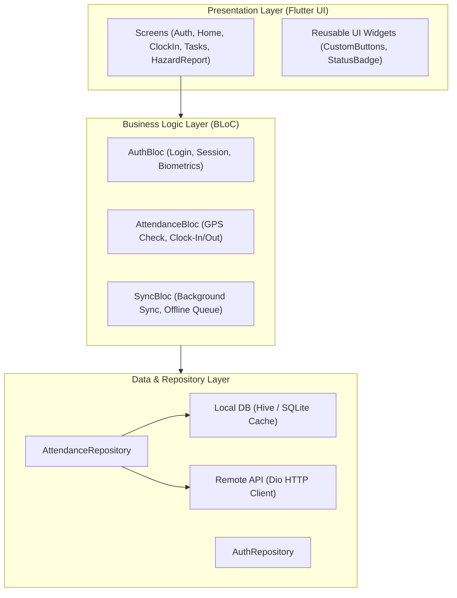

# Mobile Application Specification

## 1. Overview & Technology Choices

The **LabourLens Mobile App** (`apps/mobile`) is developed with **Flutter** (Dart), providing a unified codebase for Android and iOS devices. The application is built for harsh field environments, prioritizing battery efficiency, offline data durability, and clear outdoor readability.

- **Framework**: Flutter 3.x+ (Dart 3.x+)
- **State Management**: flutter_bloc (BLoC pattern) for strict separation of UI, domain logic, and data layers
- **Local Database**: Hive / Isar for offline event persistence
- **Location & Geofencing**: `geolocator` and `flutter_compass` with mock-location detection
- **Network Client**: Dio with interceptors for automatic token refresh and offline queue retries

---

## 2. Application Architecture



---

## 3. Key Feature Modules

### 3.1 Geofenced Attendance Clock-In / Out
1. **Location Verification**: On clock-in request, query device GPS coordinates with high accuracy (`LocationAccuracy.high`).
2. **Anti-Spoofing Check**: Detect if `isMocked` is true via native Android `Location.isFromMockProvider()` or iOS simulation detection.
3. **Ray-Casting Algorithm**: Client checks if `(lat, lng)` is within the assigned site's polygon vertices for instant UI feedback before pinging the backend API.
4. **Biometric Confirmation**: Prompt local device Face ID or fingerprint via `local_auth` package to confirm worker identity.

### 3.2 Offline-First Sync Engine
Remote worksites frequently experience intermittent or zero cellular connectivity:
- When offline, attendance clock-ins, clock-outs, and hazard reports are written to the local Hive box with status `PENDING_SYNC`.
- A background connectivity listener (`connectivity_plus`) detects when the device reconnects to Wi-Fi/4G/5G and flushes pending records in chronological sequence (`FIFO`).
- Conflicts are resolved using cryptographically signed client timestamps.

### 3.3 Hazard & Incident Reporting
- Field workers or supervisors can capture photos of safety hazards (e.g. exposed live cables, missing guardrails).
- Compressed images are cached locally and uploaded via multipart form data with GPS coordinates attached.

---

## 4. Screen Flow & Navigation

```text
Splash / Startup
│
├── Not Authenticated ──> Login Screen (Worker ID + Password / Biometrics)
│
└── Authenticated
    ├── Worker Mode
    │   ├── Home (Active Shift Status, Today's Hours)
    │   ├── Clock-In / Out Screen (Map view with Geofence boundary)
    │   ├── Tasks & Work Orders Screen
    │   └── Safety Hazard Reporting Screen
    │
    └── Supervisor Mode
        ├── Site Overview (Live Worker Count, Active Crew)
        ├── Roll Call & Manual Attendance Override
        ├── Safety Alerts Feed (Real-time PPE violations)
        └── Broadcast Emergency Announcement
```

---

## 5. Device Permissions Required

| Platform | Permission | Justification |
|---|---|---|
| Android & iOS | `ACCESS_FINE_LOCATION` | Required for site geofencing and verifying physical presence |
| Android | `ACCESS_BACKGROUND_LOCATION` | Optional background verification during active shift |
| Android & iOS | `CAMERA` | For biometric face verification and hazard photo submission |
| Android & iOS | `USE_BIOMETRIC` / `FaceID` | Local biometric authentication on device unlock |
| Android & iOS | `POST_NOTIFICATIONS` | Receiving high-priority safety and emergency evacuation alerts |

