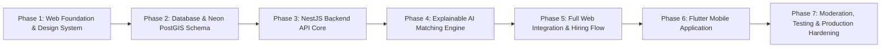

# LabourLens — Project Implementation Plan
**Project Title**: LabourLens — An Explainable AI-Based Platform for Trustworthy Matching of Domestic and Skilled Workers  
**Target Market**: Pakistan (Karachi, Lahore, Islamabad, Rawalpindi, Faisalabad, Multan, Peshawar, Quetta, and expanding)  
**Target Users**: Domestic Workers (cooks, cleaners, maids, drivers, caretakers), Skilled Workers (electricians, plumbers, carpenters, HVAC technicians, mechanics), Employers (households, property managers, small businesses), and Platform Administrators.

---

## 1. Executive Summary & Core Mandate

LabourLens is an explainable AI-driven workforce matching platform designed to solve pervasive trust, transparency, and matching inefficiencies in Pakistan's informal and semi-formal labor market. Unlike opaque black-box platforms or unregulated classified portals, LabourLens:
1. **Provides Explainable Matching**: Computes match scores across five weighted dimensions (Skill relevance, Proximity & Geolocation, Experience, Wage/Budget compatibility, and Schedule Availability) accompanied by transparent natural language reasons, matched requirements, and missing requirements.
2. **Maintains Clear Evidence Levels**: Distinguishes between `VERIFIED` credentials (e.g., CNIC, police verification certificate, trade diploma), `SELF_REPORTED` experience, and `UNAVAILABLE` data.
3. **Never Claims Safety Guarantees**: Enforces the ethical principle that identity verification and background screening mitigate risk but can never guarantee personal safety. Comprehensive safety checklists and emergency helplines are integrated across every interaction.
4. **Supports Flexible Employment**: Accommodates hourly gigs, daily wages, and project-based contract work tailored to Pakistani labor dynamics.
5. **Is Bilingual-Ready**: Designed for high accessibility in both English and Urdu with simple iconographic visual cues for low-literacy workers.

---

## 2. Multi-Phase Implementation Roadmap

### Phase 1: Web Foundation, Design System & Shared App Shell (Current Focus)
- **Goal**: Establish the Next.js 14+ App Router frontend foundation, responsive design system, bilingual-ready typography, public landing page, shared navigation and footer, and accessible route scaffolds for authentication and role-specific dashboards.
- **Deliverables**:
  - Environment inspection and monorepo alignment.
  - Next.js App Router app in `apps/web` with TypeScript, Tailwind CSS, and Lucide icons.
  - Emerald & Slate design system reflecting trust, safety, and Pakistani socioeconomic context.
  - Responsive landing page featuring domestic & skilled worker showcases, XAI preview cards, safety disclaimers, and city hubs.
  - Route skeletons with labeled demo preview states:
    - `/auth/login`, `/auth/register`
    - `/dashboard/employer` (Candidate match explanations, active job postings)
    - `/dashboard/worker` (Job opportunities, verification badge checklist, profile completeness)
    - `/dashboard/admin` (Verification queue, complaints & moderation, platform metrics)
    - `/workers`, `/jobs`, `/how-it-works`, `/safety-trust`
  - Zero-error production build (`next build`) and lint verification.

### Phase 2: Neon Cloud PostgreSQL & PostGIS Spatial Schema
- **Goal**: Define the single source of truth relational and spatial database schema using Prisma ORM connected to Neon PostgreSQL.
- **Deliverables**:
  - `database/schema.prisma` and SQL migrations.
  - PostGIS geometry extensions for latitude/longitude coordinates and spatial distance calculations (`ST_DWithin`, `ST_DistanceSphere`).
  - Core entities: `User`, `Profile`, `WorkerProfile`, `EmployerProfile`, `Skill`, `WorkerSkill`, `JobPost`, `JobRequirement`, `JobApplication`, `MatchScore`, `Review`, `VerificationDocument`, `Complaint`, `Notification`.
  - Realistic seed fixtures for Pakistani domestic trades (cook, cleaner, driver, nanny, elder caretaker) and technical trades (electrician, plumber, AC technician, carpenter, mason).
  - Explicit non-assumption of local PostgreSQL; zero hardcoded credentials using `.env.example`.

### Phase 3: NestJS Core Backend API (`apps/api`)
- **Goal**: Build high-performance, modular NestJS REST API with Argon2id password hashing, JWT authentication, RBAC guards, and shared contracts for both Web and Mobile clients.
- **Deliverables**:
  - NestJS modular architecture (`AuthModule`, `UsersModule`, `WorkersModule`, `JobsModule`, `ApplicationsModule`, `ReviewsModule`, `ModerationModule`).
  - DTO validation via `class-validator` and `class-transformer`.
  - Neon Prisma client integration and spatial queries.
  - OpenStreetMap Nominatim integration for reverse-geocoding Pakistani addresses.
  - Swagger / OpenAPI documentation reflecting `docs/API_CONTRACTS.md`.

### Phase 4: Explainable AI (XAI) Matching Engine (`services/ai`)
- **Goal**: Develop a dedicated Python FastAPI service that ingests employer job requirements and candidate pools to compute multi-factor ranked recommendations with human-readable explanations.
- **Deliverables**:
  - FastAPI service with Pydantic request/response schemas.
  - Scikit-learn feature vectorization and cosine/weighted distance scoring.
  - Transparent scoring components:
    - $S_{\text{skill}}$: Trade keyword matching and taxonomy overlap ($0 - 100\%$).
    - $S_{\text{geo}}$: Haversine / PostGIS physical distance decay curve.
    - $S_{\text{exp}}$: Years of hands-on experience vs required threshold.
    - $S_{\text{wage}}$: Budget and rate compatibility (hourly, daily, project).
    - $S_{\text{avail}}$: Shift and day overlap.
  - Explainability breakdown output:
    - Positive match justifications ("Has 4+ years of residential plumbing experience", "Within 3.5 km of Gulberg, Lahore").
    - Missing or partial requirements ("Does not possess certified master electrician license", "Demands higher hourly rate than budgeted").
    - Evidence classification (`VERIFIED_DOCUMENT`, `SELF_REPORTED_WORKER`, `UNAVAILABLE_DATA`).
  - Baseline evaluation benchmark: Precision@3 and NDCG@3 on synthetic annotated Pakistani domestic/skilled work datasets.

### Phase 5: Web Client Full Integration & Workflow Execution
- **Goal**: Connect `apps/web` with NestJS API and Python AI service.
- **Deliverables**:
  - Employer workflow: Post job -> Receive ranked candidate recommendations with XAI breakdowns -> Shortlist -> Hire -> Complete -> Rate & Review.
  - Worker workflow: Profile creation (skills, rates, CNIC submission) -> Search jobs on OpenStreetMap -> Apply -> Track application status -> Receive hiring confirmation.
  - Interactive Leaflet/OpenStreetMap integration with Pakistani city bounds.
  - Bilingual interface toggle (English / Urdu) with high-legibility Nastaliq/Naskh font support for low-literacy users.

### Phase 6: Mobile Client (`apps/mobile` - Flutter)
- **Goal**: Deliver a lightweight, offline-resilient Flutter application for field workers and mobile employers.
- **Deliverables**:
  - Flutter 3.x with BLoC architecture consuming the identical NestJS REST API.
  - Audio prompts and visual iconography for workers with basic Urdu literacy.
  - Location picker and geolocation reporting via device GPS.
  - Push notifications for job requests and application updates.

### Phase 7: Verification, Moderation, Testing & Production Hardening
- **Goal**: Ensure enterprise-grade reliability, data privacy, and security compliance.
- **Deliverables**:
  - Admin moderation panel for reviewing CNIC photos, police verification certificates, and resolving employer/worker complaints.
  - Anti-tampering and audit logging.
  - Security review: Zero exposed credentials, TLS-enforced database connections, CSRF protection, rate limiting.
  - Docker Compose orchestration and production deployment guides.

---

## 3. Strict Operating Rules
1. **Never Claim Verification Guarantees Safety**: Background checks reduce risk; they do not eliminate it. Clear warnings must accompany every profile.
2. **Only Neon Cloud Database**: Local Postgres is not assumed. Connections must support SSL mode (`sslmode=require`).
3. **No Hardcoded Secrets**: Secrets reside in `.env` (git-ignored); `.env.example` provides documentation templates.
4. **Shared Backend Contracts**: Mobile and web clients consume the exact same NestJS API endpoints.
5. **No AI Hallucinations**: Model benchmarks, accuracy metrics, and verification statuses must be empirically measured or transparently identified as demo data.
