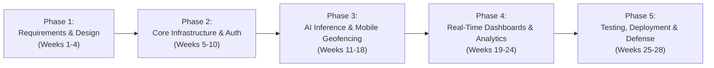

# Project Roadmap & FYP Milestones

## 1. Project Timeline Overview

LabourLens is organized across five structured phases designed for Final Year Project (FYP) milestones and industrial-grade delivery.

---

## 2. Detailed Phase Breakdown

### Phase 1: Requirements Inception & System Architecture (Weeks 1 - 4)
- [x] Complete project proposal and problem statement defense.
- [x] Define multi-tier monorepo directory layout (`apps/web`, `apps/mobile`, `apps/api`, `services/ai`).
- [x] Create comprehensive architecture specifications, database schemas, and API contracts.
- [x] Finalize hardware specifications for edge CCTV inference (GPU vs CPU benchmarks).

### Phase 2: Core Backend, Database & Authentication (Weeks 5 - 10)
- [ ] Initialize NestJS backend with Prisma ORM and PostgreSQL migrations.
- [ ] Implement JWT authentication, refresh token rotation, and RBAC guards.
- [ ] Set up Docker Compose local development stack (API, DB, Redis, MinIO).
- [ ] Implement core Worksites and Geofence CRUD endpoints with PostGIS spatial validation.

### Phase 3: AI Inference Engine & Mobile Field App (Weeks 11 - 18)
- [ ] Curate and label industrial PPE dataset (Hard Hats, Safety Vests, Boots, Gloves).
- [ ] Train, optimize, and convert YOLOv8 model weights to ONNX / TensorRT.
- [ ] Build FastAPI microservice supporting RTSP stream frame ingestion and ByteTrack tracking.
- [ ] Develop Flutter mobile client with BLoC state management, native GPS geofencing, and Hive offline storage.

### Phase 4: Web Command Center & Real-Time Analytics (Weeks 19 - 24)
- [ ] Build Next.js 14+ dashboard UI with Tailwind CSS and shadcn/ui.
- [ ] Implement interactive Mapbox geofence creation and site perimeter editor.
- [ ] Integrate WebSocket (Socket.io) gateway for sub-second safety incident broadcasts.
- [ ] Build multi-site workforce analytics, attendance reports, and PDF/CSV export modules.

### Phase 5: System Integration, Field Testing & Final Defense (Weeks 25 - 28)
- [ ] Conduct end-to-end integration tests (Mobile clock-in -> NestJS -> Web dashboard update).
- [ ] Perform stress testing on AI video pipeline with simulated multiple concurrent RTSP streams.
- [ ] Compile comprehensive FYP final report, user manuals, and demonstration video.
- [ ] Final project defense and presentation to evaluation board.

---

## 3. Academic Deliverables & Assessment Mapping

| Deliverable | Key Contents | Target Timeline |
|---|---|---|
| **FYP Proposal & SRS** | Problem statement, feasibility, functional & non-functional requirements | Week 4 |
| **Mid-Term Evaluation** | Working NestJS backend, mobile geofence clock-in demo, baseline AI detection | Week 14 |
| **Model Evaluation Report** | Confusion matrix, mAP@0.5, FPS benchmarks, false positive analysis | Week 20 |
| **Final Dissertation** | Literature review, architecture, algorithmic design, empirical results | Week 26 |
| **Live Defense & Demo** | Live CCTV camera PPE violation detection, mobile app, and web dashboard | Week 28 |

