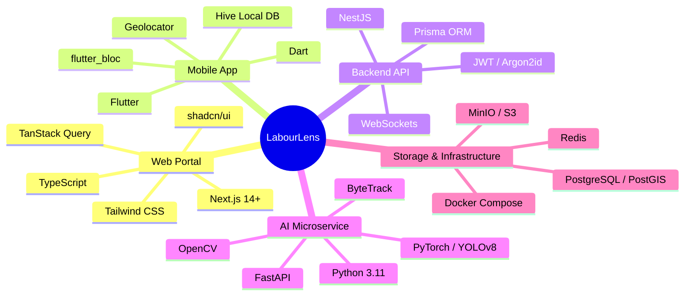

# LabourLens Documentation Hub

Welcome to the comprehensive documentation suite for **LabourLens** (Final Year Project). This documentation has been structured to allow any AI agent or software engineer to understand the architecture, API contracts, database design, AI pipelines, and development workflows.

---

## Documentation Index

| Document | Description |
|---|---|
| [**AGENTS.md**](../AGENTS.md) | **Essential Agent Guide**: Mental model, directory navigation, coding conventions, rules, and commands. |
| [**ARCHITECTURE.md**](./ARCHITECTURE.md) | High-level system architecture, multi-tier topology, Mermaid flowcharts, communication protocols, and sub-systems. |
| [**SYSTEM_REQUIREMENTS.md**](./SYSTEM_REQUIREMENTS.md) | Functional Requirements (FR), Non-Functional Requirements (NFR), user personas, and acceptance criteria. |
| [**API_SPECIFICATION.md**](./API_SPECIFICATION.md) | REST endpoints specification, JSON schemas, WebSocket gateways, status codes, and error models. |
| [**DATABASE_DESIGN.md**](./DATABASE_DESIGN.md) | Entity-Relationship (ER) diagram, PostgreSQL tables, PostGIS spatial indexing, and schema dictionary. |
| [**AI_ML_PIPELINE.md**](./AI_ML_PIPELINE.md) | Computer vision models, YOLOv8 PPE detection, ByteTrack tracking, RTSP ingestion, and benchmark metrics. |
| [**MOBILE_APP_SPEC.md**](./MOBILE_APP_SPEC.md) | Flutter application architecture, BLoC pattern, offline-first sync engine, GPS geofencing, and permissions. |
| [**WEB_APP_SPEC.md**](./WEB_APP_SPEC.md) | Next.js 14+ App Router, dashboard layouts, real-time CCTV monitoring, TanStack Query, and RBAC UI guards. |
| [**DEPLOYMENT_AND_DEVOPS.md**](./DEPLOYMENT_AND_DEVOPS.md) | Docker Compose multi-container topology, Nginx proxy, CI/CD pipeline, and environment configuration. |
| [**SECURITY_AND_COMPLIANCE.md**](./SECURITY_AND_COMPLIANCE.md) | Worker privacy, face redaction, OSHA compliance, Argon2id hashing, and threat modeling. |
| [**DATA_FLOW.md**](./DATA_FLOW.md) | End-to-end Mermaid sequence diagrams for attendance clock-in, PPE violation detection, and offline sync. |
| [**PROJECT_ROADMAP.md**](./PROJECT_ROADMAP.md) | FYP milestones, deliverables, phases, academic defense requirements, and timeline. |
| [**GLOSSARY.md**](./GLOSSARY.md) | Industrial safety, AI/CV, geospatial, and software architecture terminology. |

---

## Tech Stack Summary

