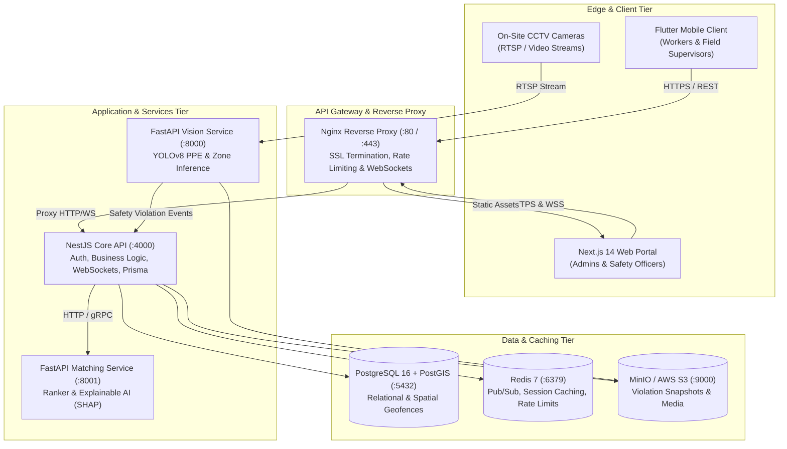

# System Architecture & Topology

## 1. Multi-Tier Distributed Architecture

LabourLens implements a micro-modular topology separating edge devices, transactional business logic, high-throughput video intelligence, and executive analytics.

---

## 2. Component Responsibilities

### 2.1 Next.js 14 Web Portal (`apps/web`)
- Server Components for high-performance rendering of sites, timesheets, and audit ledgers.
- Client components for interactive Mapbox geofence editing and WebRTC/HLS live video stream monitoring.
- Socket.io client integration for instant safety violation alerts.

### 2.2 Flutter Mobile App (`apps/mobile`)
- Offline-first attendance engine with local Hive storage.
- Anti-spoof GPS geofencing utilizing ray-casting algorithms.
- Native biometric authentication (`local_auth`) for passwordless worker clock-in.

### 2.3 NestJS Core API (`apps/api`)
- Domain-driven controllers, services, repositories, and DTO validation.
- Short-lived JWT access tokens and database-backed rotating refresh tokens.
- Socket.io gateway broadcasting real-time site events to connected clients.

### 2.4 AI Microservices (`services/ai`)
- **Vision Subsystem**: OpenCV/PyAV RTSP frame ingestion, YOLOv8 inference, ByteTrack multi-object tracking, and automated bounding-box rendering.
- **Matching Subsystem**: Tabular machine learning model ranking candidate workers against job requisitions with SHAP explainability feature attribution.
