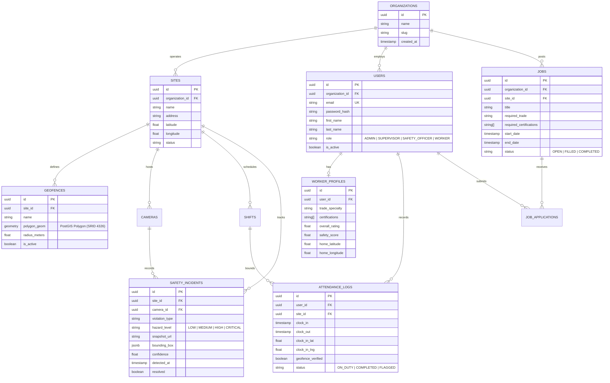

# Database Schema & Relational Models

## 1. Relational Entity Overview

The LabourLens PostgreSQL schema stores enterprise organizational entities, spatial geofences, worker profiles, job requisitions, attendance logs, and real-time safety violations.



---

## 2. Table Specifications & Indexes

### 2.1 PostGIS Geofence Spatial Index
```sql
CREATE EXTENSION IF NOT EXISTS postgis;

CREATE TABLE geofences (
    id UUID PRIMARY KEY DEFAULT gen_random_uuid(),
    site_id UUID NOT NULL REFERENCES sites(id) ON DELETE CASCADE,
    name VARCHAR(100) NOT NULL,
    polygon_geom GEOMETRY(Polygon, 4326) NOT NULL,
    is_active BOOLEAN DEFAULT TRUE,
    created_at TIMESTAMPTZ DEFAULT NOW()
);

-- Fast spatial containment index
CREATE INDEX idx_geofences_spatial ON geofences USING GIST (polygon_geom);
```

### 2.2 Attendance Logs Indexing Strategy
```sql
CREATE INDEX idx_attendance_user_site ON attendance_logs (user_id, site_id, clock_in DESC);
CREATE INDEX idx_attendance_date_status ON attendance_logs (clock_in DESC, status);
```

### 2.3 Safety Incidents Triage Index
```sql
CREATE INDEX idx_safety_unresolved ON safety_incidents (site_id, detected_at DESC) WHERE resolved = FALSE;
```

