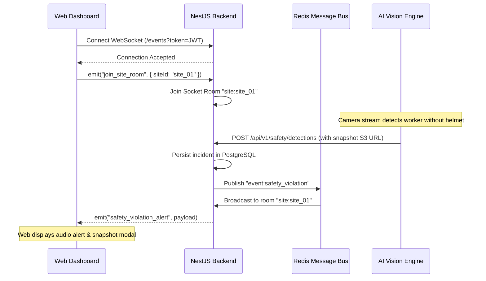

# System Design & Internal Mechanisms

## 1. Design Patterns Applied

### 1.1 Backend Patterns (NestJS)
- **Modular Monolith**: Features are partitioned into domain modules (`AuthModule`, `AttendanceModule`, `JobsModule`, `SafetyModule`, `SitesModule`).
- **Data Transfer Objects (DTO) with Validation**: Strict input parsing using `class-validator` and `class-transformer` decorators to enforce type safety at the network boundary.
- **Dependency Injection (DI)**: Inversion of control container allowing easy mocking of repositories and external microservices during automated testing.
- **Interceptor Pattern**: Logging interceptors record request durations, error interceptors format unified JSON responses, and transformation interceptors strip out sensitive fields (like `password_hash`).

### 1.2 Frontend Patterns (Next.js & Flutter)
- **App Router & Server Components (Next.js)**: Separation between server-rendered data grids and client-side interactive islands (map drawers, camera players).
- **BLoC Pattern (Flutter)**: Unidirectional data flow (`Events -> Bloc -> States`). Keeps presentation UI dumb and decoupled from network and local storage repositories.
- **Repository Pattern**: Centralizes data fetching and abstracts whether data originates from local cache (Hive) or remote HTTP (Dio).

---

## 2. Distributed Communication & Event Flow

---

## 3. High-Concurrency & Scalability Tactics

1. **Stateless Compute**: NestJS and FastAPI pods can scale horizontally behind Nginx load balancers.
2. **Database Query Offloading**: Frequently accessed static datasets (worksites, shift templates, active geofence polygons) are cached in Redis with a 15-minute TTL.
3. **Asynchronous Frame Ingestion**: Camera RTSP streams are sampled at 5-10 FPS into an in-memory queue, preventing thread starvation in the Python event loop.

