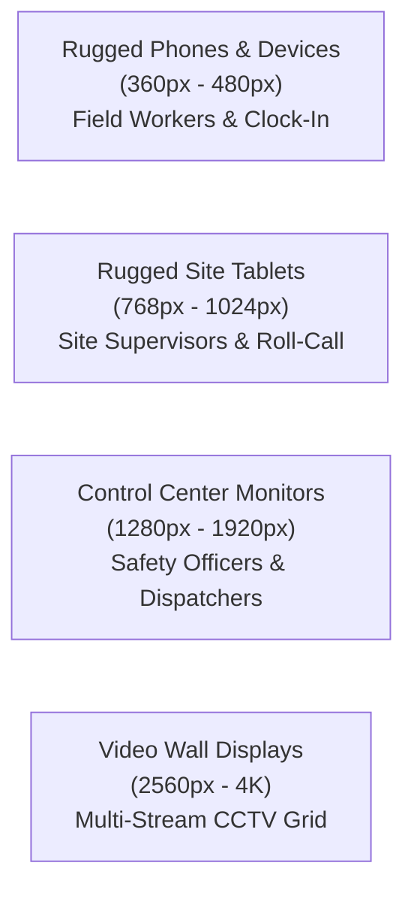

# Responsive Design & Multi-Device Strategy

## 1. Supported Viewports & Form Factors

LabourLens is designed to adapt smoothly across all relevant industrial form factors:

---

## 2. Tailwind Breakpoint Conventions

| Breakpoint | Minimum Width | Target Layout Behavior |
|---|---|---|
| `sm` | $640\text{ px}$ | Mobile landscape; collapse navigation drawer into bottom bar |
| `md` | $768\text{ px}$ | Tablet portrait; 2-column KPI grid, floating action sheets |
| `lg` | $1024\text{ px}$ | Tablet landscape / Laptop; fixed sidebar, 4-column KPI grid |
| `xl` | $1280\text{ px}$ | Standard desktop; 4-camera CCTV live grid + incident feed sidebar |
| `2xl` | $1536\text{ px}$ | Large desktop; 6-camera CCTV live grid + full analytics panels |

---

## 3. High-Density & Outdoor Optimization Strategies

1. **Automatic Sunlight Mode**: Leverages ambient light sensors on mobile to dynamically boost contrast and swap subtle borders for solid 2px high-visibility outlines.
2. **Video Wall Fullscreen Mode**: The CCTV monitoring page (`/cameras`) features a 1-click "Video Wall Mode" that strips away navigation headers and sidebars, allocating 100% of the screen real-estate to low-latency camera streams with bounding-box annotations.
