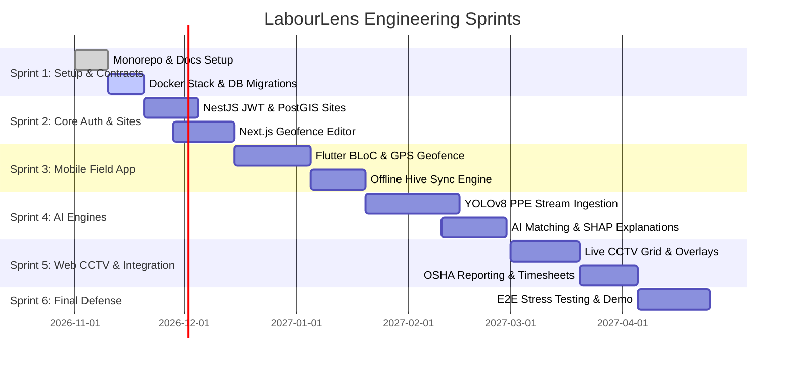

# Development Roadmap & Sprint Plan

## 1. Roadmap Milestones

---

## 2. Sprint Deliverables

- **Sprint 1 (Weeks 1-2)**: Monorepo scaffolding, database schemas, Docker Compose environment, comprehensive documentation.
- **Sprint 2 (Weeks 3-5)**: NestJS Core API authentication, user management, worksites, and PostGIS geofence CRUD.
- **Sprint 3 (Weeks 6-9)**: Flutter mobile app, GPS geofencing, mock location traps, and offline sync engine.
- **Sprint 4 (Weeks 10-14)**: Python AI microservices for YOLOv8 PPE detection and XGBoost job-worker matching.
- **Sprint 5 (Weeks 15-18)**: Next.js executive portal, live camera stream overlays, and real-time WebSocket alert feed.
- **Sprint 6 (Weeks 19-22)**: Stress testing, security hardening, final project defense presentation, and dissertation.
