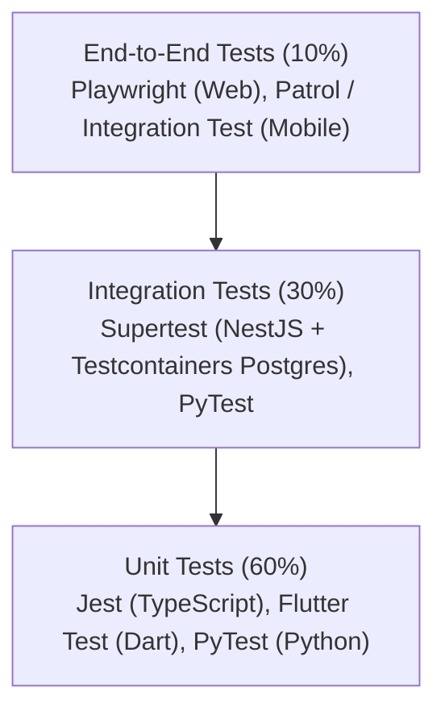

# Comprehensive Testing Strategy

## 1. Testing Pyramid Overview

LabourLens adheres to a 3-tier testing pyramid:

---

## 2. Test Suites by Component

### 2.1 Backend API (`apps/api`)
- **Unit Testing**: Jest tests validating isolated services, custom decorators, and DTO validators.
- **Integration Testing**: Supertest spinning up an ephemeral PostgreSQL + PostGIS container via Testcontainers to verify:
  - Complex spatial query execution (`ST_Contains`).
  - Refresh token rotation and token family invalidation.
  - WebSocket event broadcast handling.

### 2.2 Mobile Client (`apps/mobile`)
- **Unit Testing**: BLoC tests using `bloc_test` to verify event-to-state stream transitions.
- **Mocking**: Mocking GPS location streams via `geolocator` mock providers.
- **Offline Resync Test**: Simulating network disconnection, queueing 5 shift check-ins, restoring network, and asserting FIFO upload order.

### 2.3 AI Microservices (`services/ai`)
- **Inference Unit Tests**: Asserting model output tensor shapes $[B, N, 6]$ on static test frames.
- **Edge Case Tests**: Frame with 0 persons, frame with 50 persons, pitch-black night vision frame.
- **Regression Benchmark**: CI script verifying that class mAP does not drop below $0.88$.

### 2.4 Web Frontend (`apps/web`)
- **Component Tests**: React Testing Library testing rendering of KPI stat cards, alerts, and tables.
- **E2E Tests**: Playwright scripts executing end-to-end flows: supervisor logs in, draws a geofence on the map, and saves the site.

