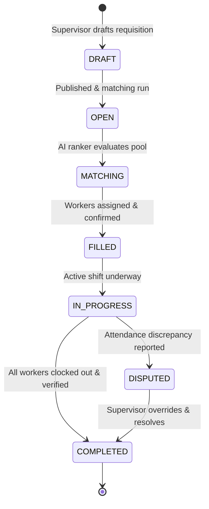

# Job & Shift Management Feature Specification

## 1. Feature Overview

The **Job & Shift Management Subsystem** empowers site supervisors and project managers to translate construction/industrial project milestones into concrete staffing shifts, define trade requirements, assign verified labor, and monitor execution.

---

## 2. Job Lifecycle State Machine

---

## 3. Data Schema & Job Parameters

When creating a job requisition, the supervisor specifies:
- **Title & Description**: e.g. "Reinforced Concrete Pouring - Section 4B"
- **Worksite**: Link to active `sites` record with defined geofence.
- **Trade Requirements**: Required primary trade (e.g. Mason, Welder, Electrician, Heavy Crane Operator).
- **Required Certifications**: Mandatory licenses (e.g. OSHA-10, Working at Heights).
- **Shift Schedule**: Start date/time and anticipated end date/time.
- **Headcount Required**: Number of workers required for the shift.
- **Urgency Level**: `NORMAL`, `HIGH`, `EMERGENCY_REPLACEMENT`.

---

## 4. One-Click AI Dispatch Workflow

1. Supervisor navigates to `/jobs/create` and completes the job parameters.
2. Clicks **"Find Optimal Candidates"**.
3. NestJS triggers `POST /matching/recommend-candidates` to the Python AI service.
4. AI service computes scores, applies hard constraints, calculates SHAP explanations, and returns the top ranked candidates.
5. Supervisor inspects the transparent score breakdown (e.g., proximity, past rating) and clicks **"Confirm & Dispatch"**.
6. Assigned workers instantly receive push notifications on their Flutter mobile app to accept or decline the shift.

