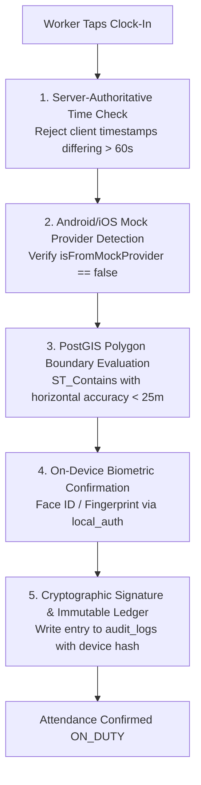

# Trust, Verification & Anti-Fraud Mechanisms

## 1. Threat Models & Attack Vectors

In labor monitoring and industrial operations, financial and physical integrity can be compromised by bad actors:

| Threat Vector | Attack Mechanism | Impact |
|---|---|---|
| **Buddy Punching** | Worker A gives phone/credentials to Worker B to clock in while absent | Payroll fraud and inaccurate safety muster lists during emergencies |
| **GPS Spoofing** | Worker uses mock GPS software to simulate presence on site | False attendance logging from outside worksite |
| **Time-Drift Manipulation** | Changing mobile device system clock to register early arrival | Corrupted attendance audit logs |
| **Credential Forgery** | Submitting fabricated safety licenses (e.g. fake crane operator license) | Severe industrial accidents and regulatory liability |

---

## 2. Multi-Layer Anti-Fraud Defense Architecture

---

## 3. Defense Mechanisms in Detail

### 3.1 Device Anti-Spoofing & Mock Location Traps
The Flutter mobile application interfaces with native operating system APIs:
- **Android**: Queries `location.isFromMockProvider()` and tests developer mode mock location app assignments.
- **iOS**: Verifies simulation flags via `CLLocation` flags.
- If mock location is detected, the event is immediately terminated, an alert is broadcast to the site supervisor, and the device ID is flagged.

### 3.2 Server-Authoritative Timestamps
Clients submit their local timestamp for network latency calculation, but the authoritative shift start/end timestamps are recorded exclusively by the PostgreSQL database using `NOW() AT TIME ZONE 'UTC'`.

### 3.3 Certificate Expiration Audits
An automated daily cron job checks worker license validity:
- If an OSHA or equipment license expires, the worker's status is automatically downgraded to `CERT_EXPIRED`.
- The AI matching engine immediately halts recommendation of the candidate for jobs requiring that license until a renewed certificate is verified by an admin.
