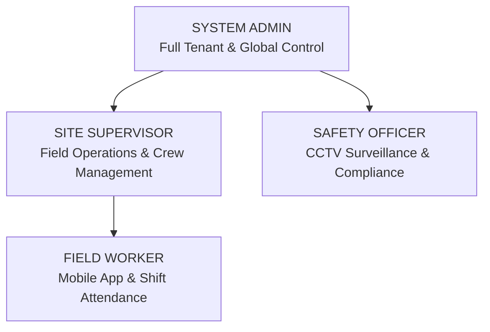

# User Roles & Access Control (RBAC)

## 1. Role Definitions

LabourLens defines four core hierarchical roles:



---

## 2. Granular Permissions Matrix

| Permission Key | Description | Admin | Supervisor | Safety Officer | Worker |
|---|---|:---:|:---:|:---:|:---:|
| `users.manage` | Create, invite, or deactivate employee accounts | :white_check_mark: | :x: | :x: | :x: |
| `sites.manage` | Create sites, draw and modify geofences | :white_check_mark: | :x: | :x: | :x: |
| `cameras.configure` | Add RTSP streams, define hazard red-zones | :white_check_mark: | :x: | :white_check_mark: | :x: |
| `jobs.create` | Create job requisitions and post shifts | :white_check_mark: | :white_check_mark: | :x: | :x: |
| `jobs.assign` | Execute AI matching and assign workers to jobs | :white_check_mark: | :white_check_mark: | :x: | :x: |
| `attendance.clock` | Perform GPS-verified clock-in and clock-out | :x: | :white_check_mark: | :x: | :white_check_mark: |
| `attendance.override` | Manually adjust late/missed clock-in records | :white_check_mark: | :white_check_mark: | :x: | :x: |
| `safety.monitor` | View real-time CCTV streams and detection overlays | :white_check_mark: | :white_check_mark: | :white_check_mark: | :x: |
| `safety.resolve` | Dismiss or resolve safety violation alerts | :white_check_mark: | :white_check_mark: | :white_check_mark: | :x: |
| `reports.export` | Export OSHA reports and payroll timesheets | :white_check_mark: | :white_check_mark: | :white_check_mark: | :x: |
| `hazard.report` | Capture and submit on-site hazard photos | :white_check_mark: | :white_check_mark: | :white_check_mark: | :white_check_mark: |

---

## 3. Enforcement in Code

### 3.1 Backend NestJS Guard
Guards inspect JWT payload claims and compare against `@Roles()` metadata:
```typescript
@UseGuards(JwtAuthGuard, RolesGuard)
@Roles('ADMIN', 'SUPERVISOR')
@Post('jobs')
async createJob(@Body() dto: CreateJobDto) {
  return this.jobsService.create(dto);
}
```

### 3.2 Frontend Route & Component Protection
Components wrap privileged controls with role-checking helpers:
```tsx
<RoleGate allowedRoles={['SAFETY_OFFICER', 'ADMIN']}>
  <LiveCameraGrid siteId={activeSiteId} />
</RoleGate>
```
