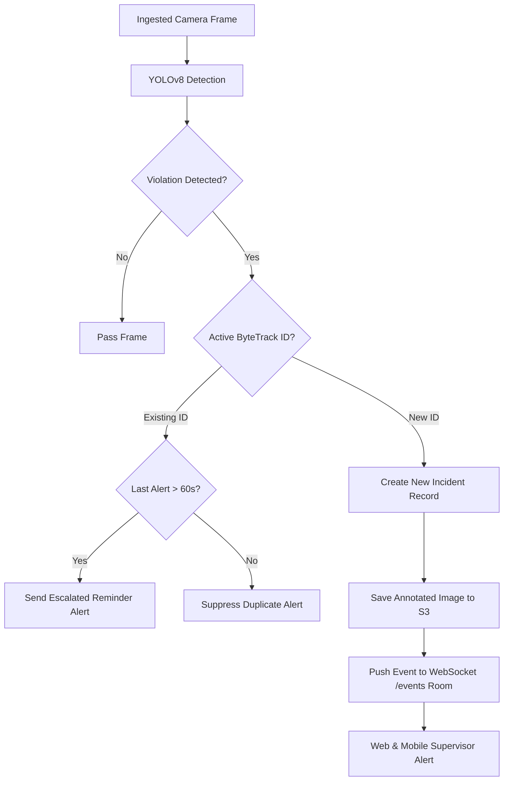

# Core Business Logic & Domain Rules

## 1. Attendance & Shift Verification Rules

### 1.1 Geofence Containment Validation
1. An attendance check-in request is valid if and only if the client's reported coordinate $(lat, lng)$ satisfies:
   $$\text{ST\_Contains}(\text{geofence\_geom}, \text{ST\_SetSRID}(\text{ST\_Point}(lng, lat), 4326)) = \text{true}$$
2. If GPS horizontal accuracy radius $> 25\text{ meters}$, the system flags the log as `ACCURACY_LOW` and requires supervisor approval.
3. If `isMockLocation == true`, the request is immediately rejected with HTTP `400 Bad Request` and logged in `audit_logs` under security alerts.

### 1.2 Shift Status Calculation
- **On-Time**: Clock-in occurs within $[T_{start} - 15\text{m}, T_{start} + 10\text{m}]$.
- **Late**: Clock-in occurs between $T_{start} + 10\text{m}$ and $T_{start} + 60\text{m}$. Shift status marked as `LATE`.
- **Absent**: If no clock-in recorded by $T_{start} + 60\text{m}$, status defaults to `ABSENT` and supervisor is alerted to assign a replacement.
- **Overtime**: Work logged beyond scheduled $T_{end} + 30\text{m}$ enters `PENDING_OVERTIME_APPROVAL` state, requiring supervisor signature.

---

## 2. AI Matching & Allocation Business Logic

### 2.1 Multi-Objective Composite Score
The match score $S_{total}(w, j) \in [0.0, 1.0]$ between worker $w$ and job $j$ is computed as:
$$S_{total}(w, j) = w_s \cdot S_{skill} + w_d \cdot S_{dist} + w_r \cdot S_{rel} + w_c \cdot S_{safe}$$

Where default enterprise weights are:
- $w_s = 0.40$ (Trade Skill & Experience Fit)
- $w_d = 0.25$ (Geographic Proximity & Commute Cost)
- $w_r = 0.20$ (Historical Attendance & Punctuality Reliability)
- $w_c = 0.15$ (Safety Score & Clean Safety Violation Record)

### 2.2 Hard Constraint Disqualification Filter
A candidate is disqualified ($S_{total} = 0$) if:
- Candidate lacks a required mandatory safety certification (e.g. OSHA-30, Confined Space Entry, High-Voltage Handling).
- Distance $D(w, j) > D_{max}$ (where $D_{max}$ is maximum allowable daily commute threshold, default 50km).
- Worker is already committed to an overlapping active shift.

---

## 3. Safety Violation & Alert Throttling Logic

### 3.1 Severity Matrix
- **`CRITICAL`**: Fall detected OR human in designated Red Zone (crane/demolition) without harness. Instant audible chime and SMS/Push alert.
- **`HIGH`**: Missing Hard Hat in active construction zone. Highlighted notification modal.
- **`MEDIUM`**: Missing High-Visibility Vest or Gloves in staging area. Dashboard notification badge.
- **`LOW`**: Minor equipment deviation. Logged to daily compliance summary report.
