# LabourLens - Feature Catalog

## 1. Feature Classification

```mermaid
graph TD
    Features[LabourLens Features]
    Features --> Core[Core Workforce & Attendance]
    Features --> AIMatch[AI Labor Matching]
    Features --> AIVision[AI Vision Safety Monitoring]
    Features --> Management[Management & Analytics]

    Core --> C1[Polygonal Geofenced Check-in]
    Core --> C2[Anti-Mock Location Guard]
    Core --> C3[Offline Sync Queue]
    Core --> C4[Biometric Verification]

    AIMatch --> M1[Multi-Criteria Scoring Engine]
    AIMatch --> M2[Explainable AI Score Cards]
    AIMatch --> M3[Certification & Trade Verification]
    AIMatch --> M4[Proximity & Travel Optimization]

    AIVision --> V1[YOLOv8 PPE Detection]
    AIVision --> V2[Restricted Red Zone Breach]
    AIVision --> V3[ByteTrack Anti-Duplicate Throttling]
    AIVision --> V4[Sub-Second WebSocket Alerts]

    Management --> A1[Live CCTV Multi-Stream Grid]
    Management --> A2[Interactive Map Geofence Editor]
    Management --> A3[Digital Muster Roll Call]
    Management --> A4[OSHA Safety Audit Export]
```

---

## 2. Detailed Feature Descriptions

### 2.1 Core Workforce & Attendance
- **Polygon Geofencing**: Administrators draw custom site boundaries on a map. Mobile app calculates ray-casting point-in-polygon logic locally and confirms via PostGIS on the backend.
- **Anti-Spoofing Defense**: Inspects Android and iOS native mock location provider flags, rejecting mocked or developer-simulated coordinates.
- **Offline Storage & Resync**: Full local SQLite/Hive caching allows field workers to record shift events underground or in remote areas. Events sync automatically in chronological order when connectivity is restored.
- **Biometric Identity Confirmation**: Seamless local verification via Face ID or fingerprint before clock-in prevents sharing credentials.

### 2.2 AI Labor Matching & Allocation
- **Smart Candidate Ranking**: Ranks candidates based on a weighted composite of skill similarity, distance to jobsite, safety compliance record, and past reliability.
- **Explainable Match Cards**: Displays transparent explanations (e.g., "+35% required OSHA-30 certified, +25% within 10km radius, -10% limited experience on high-rise scaffolding").
- **Credential Verification System**: Enforces hard constraints: candidates lacking mandatory safety certificates are disqualified from hazardous assignments.

### 2.3 AI Vision Safety Monitoring
- **Automated PPE Inspection**: Continuous inference over camera streams detects absence of mandatory gear: hard hat, high-vis vest, gloves, and boots.
- **Virtual Red-Zone Intrusion**: Safety officers define polygon hazard zones over camera frames (e.g. crane swing perimeter). Any human bounding box intersecting the zone triggers an instant critical alarm.
- **ByteTrack Tracking & Alert Throttling**: Tracks individuals across video frames to prevent spamming notifications for the same worker within a 60-second window.

### 2.4 Executive Management & Reporting
- **Live Video Surveillance Grid**: Displays up to 6 simultaneous camera feeds with dynamic bounding boxes rendered in green (compliant) or red (violation).
- **Interactive Geofence Editor**: Visual editor for drawing, resizing, and activating worksite boundaries and assigning supervisor teams.
- **Automated Safety Reports**: Pre-formatted PDF and Excel exports ready for regulatory bodies (such as OSHA) detailing safety index trends and incident resolution times.

