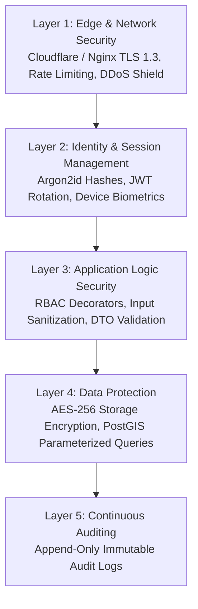

# Enterprise Security Architecture

## 1. Threat Profile & Defense in Depth

LabourLens operates across public mobile networks, private on-site CCTV networks, and cloud application servers. Security is implemented across multiple defensive layers:

---

## 2. Authentication & Credential Lifecycle

### 2.1 Cryptographic Storage
- **User Passwords**: Never stored in plain text. Hashed using **Argon2id** (`t=3, m=65536, p=1`), which resists both GPU and ASIC brute-force attacks.
- **Biometric Vectors**: Extracted facial embeddings are encrypted using AES-256-GCM before storage in the database.

### 2.2 Token Architecture
- **Access Token**: Short-lived (15 minutes), containing user ID, organization ID, and role. Signed with RSA-256 / HS256 secret.
- **Refresh Token**: Long-lived (7 days), stored hashed in Redis/Postgres. Revoked upon password reset, logout, or detection of concurrent duplicate refresh attempts (Token Family Reuse Detection).

---

## 3. Network & Transport Security

- **Mandatory HTTPS**: TLS 1.3 enforced with strict HSTS (`Strict-Transport-Security: max-age=31536000; includeSubDomains`).
- **CCTV Stream Isolation**: Camera RTSP streams are isolated on a physical or virtual industrial VLAN, communicating with the AI service over secure IPsec/WireGuard tunnels or authenticated RTSPS.
- **API Rate Limiting**: NestJS `ThrottlerModule` backed by Redis limits unauthenticated auth attempts to 5 per minute per IP, and authenticated queries to 120 per minute.

